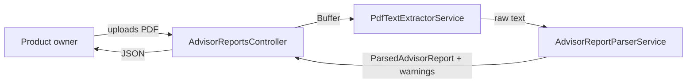

# PDF extraction reliability validation (E01-S01)

## 📝 TLDR

The product owner receives a daily PDF report from one external investment advisor (portfolio composition, decisions/commentary, a 7-point sentiment rating per market, a "3 companies for 3 months" sub-portfolio, and a weekly "growth stocks of the week" list), currently read by hand. This spec adds a PDF-to-structured-data extraction pipeline and an admin-only manual-verification endpoint so the owner can feed real PDFs through it and compare the output against his own reading — the "named experiment" the product brief calls for to test whether PDF extraction is reliable (`A03`) before anything is built on top of it. No data is persisted yet; storage is later stories (`E01-S02`–`S04`).

## 📝 Problem Statement

`.ai/specs/product-brief.md` (Problems, `[INTERVIEW]`) and GitHub issue `E01-S01` (#2, epic #1) establish: nothing today turns the advisor's daily PDF into structured data, and whether that is even reliably possible is untested (`A03`, the riskiest assumption in the brief). The product owner's own kill criterion for the next phase (reconstructing the advisor's strategy, `D04`) only makes sense once extraction itself is trustworthy — so this has to be proven first, in isolation, before any storage or performance-tracking code is built on top of possibly-wrong extracted data.

## 📝 Proposed Solution

Build a small, isolated extraction pipeline — PDF buffer → raw text → structured report — exposed through a single admin-only HTTP endpoint that returns the parsed result plus a list of warnings for anything it could not confidently extract. The product owner uploads a real daily PDF through this endpoint and compares the JSON response against his own reading of the same PDF; that manual comparison *is* the acceptance test this story exists to support, not something this spec can run for him; see Open Questions.

**Alternatives considered:**
- *Build straight into the full ingest-and-store pipeline (what `E01-S02`–`S04` will need).* Rejected: storing data extracted by an unvalidated parser risks accumulating wrong history that later stories build on. Validating extraction alone first is cheaper to redo if the format assumption turns out wrong.
- *Have the owner paste PDF text manually instead of uploading a file.* Rejected: it skips testing the part most likely to fail — turning an actual PDF into text — which is exactly what `A03` needs to test.

## 📝 Architecture

New, self-contained Nest module, `AdvisorReportsModule`, following this repository's existing per-feature-directory convention (`src/<feature>/`, per `CODE_REVIEW.md`):

- `PdfTextExtractorService` — thin wrapper around the `pdf-parse` library; `Buffer` → raw text string. The only part of this feature touching a PDF-parsing library, so a future library swap stays contained here.
- `AdvisorReportParserService` — pure function over raw text → `ParsedAdvisorReport` + `warnings: string[]`. No I/O, fully unit-testable with plain string fixtures.
- `AdvisorReportsController` — `POST /admin/advisor-reports/extract`, reusing the existing `BasicAuthGuard` (same guard already protecting `/admin`, per `CODE_REVIEW.md`'s guard convention) — no new auth mechanism.
- `AdvisorReportsModule` — wires the above; no dependency on `DatabaseModule` (nothing persisted in this story).



All three components are new; nothing existing is changed. `DatabaseService`/`DatabaseModule` are not touched by this story.

## 📝 Data Model

None. This story extracts and returns data; it stores nothing. `ParsedAdvisorReport` (below) is a plain TypeScript interface, not a persisted entity — persistence is `E01-S02`–`S04`.

```ts
type SentimentRating =
  | 'bardzo-negatywna' | 'negatywna' | 'umiarkowanie-negatywna'
  | 'neutralna'
  | 'umiarkowanie-pozytywna' | 'pozytywna' | 'bardzo-pozytywna';

interface PortfolioHolding { name: string; ticker: string; weightPercent: number }

interface ParsedAdvisorReport {
  portfolio: PortfolioHolding[];
  decisionsCommentary: string | null;
  sentimentByMarket: Record<string, SentimentRating>;
  threeCompaniesThreeMonths: PortfolioHolding[];
  growthStocksOfTheWeek: string[];
}
```

## 📝 API Contracts

`POST /admin/advisor-reports/extract`
- Auth: `BasicAuthGuard` (existing `/admin` credentials).
- Request: `multipart/form-data`, single field `file`, the PDF.
- Response `200`: `{ "report": ParsedAdvisorReport, "warnings": string[] }`.
- Response `400`: `{ "error": string }` — missing file, non-PDF content, or the PDF could not be parsed into any text at all.
- No pagination, no other verbs; this is a single manual-verification action, not a resource.

## 📝 UI/UX

None — this is a plain JSON endpoint for the owner to call directly (e.g. via `curl` or a REST client) while manually comparing output to a PDF he already has open. No screen is proposed; building one is out of scope for validating `A03` and would be wasted if the parser needs rework.

## 📝 Edge Cases & Failure Scenarios

- **Non-PDF or empty upload** → `400` with a plain error; never attempt to parse garbage as if it were a PDF.
- **PDF with no extractable text (e.g. a scanned image)** → the extractor returns empty text; the parser returns an empty report with a warning `"no text extracted from PDF"` rather than guessing.
- **A section the parser expects is missing** (e.g. no "3 companies for 3 months" block in a given day's PDF) → that field is empty/absent in the response, **not fabricated**, with a corresponding warning — this is the behavior `E01-S04`'s own acceptance criteria later depend on, so it has to be right here first.
- **A market mentioned without a recognizable sentiment phrase** → omitted from `sentimentByMarket`, with a warning naming the market — never a guessed category.
- **Unrecognized document entirely** (none of the expected section headers found) → the whole response is empty data plus warnings per missing section; the endpoint still returns `200` (it did its job: reporting that it could not confidently extract anything), not a `500`.

## 📝 Risks & Impact Review

- **The exact text layout of the advisor's PDF is not known to this spec** — it is inferred from the product owner's description (portfolio, decisions/comments, a 7-point sentiment scale, two named sub-portfolios), not from an actual sample. The section-header keywords and holding-line pattern below are a best guess and will likely need tuning once real PDFs are run through this endpoint. This is exactly what the acceptance criteria (and `A03`) exist to surface — see the resolved assumption below, marked `⚠ NEEDS HUMAN CONFIRMATION`.
- No existing contract, schema, or route changes; this is new, additive, and reuses the existing admin guard. No migration/rollback concerns (nothing persisted).
- No sensitive personal data: the advisor's portfolio and commentary are not personal data about the product owner; nothing here touches credentials beyond the already-existing `BasicAuthGuard`.

## 📝 Decisions in play

- `D02` — MVP centers on this one advisor's real data, not a hypothetical strategy; this story is the first concrete piece of that.
- `A03` — the riskiest assumption this story exists to test (can the PDFs be parsed reliably?); this spec does not resolve `A03` itself, it builds the tool the product owner uses to test it.

## Resolved assumptions (autonomous defaults)

- **Q1 — Exact PDF section headers and layout.** No real PDF sample was available to this run. Default: assume Polish section headers (`Skład portfela`, `Decyzje i komentarz`, `Ocena sentymentu`, `3 spółki na 3 miesiące`, `Spółki prowzrostowe tygodnia`) matched case-insensitively, one holding per line as `Name (TICKER) — NN%`, and sentiment lines as `Market: <one of the 7 category phrases from the interview>`. Rationale: smallest-surface, most reversible choice — a pure-text parser with isolated, named patterns that are cheap to adjust once real PDFs are compared, versus guessing a binary/structured format that would be far more expensive to redo. `⚠ NEEDS HUMAN CONFIRMATION` — this must be checked against a real PDF before the output can be trusted; that check is this story's whole purpose.
- **Q2 — PDF-parsing library.** Default: `pdf-parse@^1.1.1` (pure JavaScript, `debug` + `node-ensure` only — no native build step, unlike newer `pdf-parse` majors which pull in `@napi-rs/canvas`). Rationale: lowest CI risk, smallest dependency footprint, text-only extraction is all this story needs.
- **Q3 — No UI.** Default: a plain authenticated JSON endpoint, no screen. Rationale: `own`-mode brief, single user, smallest surface to test `A03`; a UI can follow once the parser is trusted.

## 📋 Phasing

- **Phase 1 (this spec, one PR):** extraction pipeline + manual-verification endpoint. Independently shippable and leaves the app working; it adds a capability without touching anything existing.

## 📋 Implementation Plan

**Phase 1 — Extraction pipeline and manual-verification endpoint**

1. Add `pdf-parse@^1.1.1` (dependency) and `@types/pdf-parse` + `pdf-lib` (devDependencies, the latter only for generating a tiny test-fixture PDF). Implement `PdfTextExtractorService.extractText(buffer: Buffer): Promise<string>` wrapping `pdf-parse`. Unit test: a minimal one-page PDF built with `pdf-lib` in the test, asserting the known text comes back; a corrupt-buffer case asserting the rejection is surfaced, not swallowed.
2. Implement `ParsedAdvisorReport`, `SentimentRating`, `PortfolioHolding` types and `AdvisorReportParserService.parse(text: string): { report: ParsedAdvisorReport; warnings: string[] }` per the Resolved assumptions' section-header/line patterns. Unit tests covering: full happy-path text with all five sections; a holding line; a sentiment line for each of the 7 categories; a missing section (warning, no fabrication); an unrecognized market sentiment line (warning, omitted); completely unrecognized text (all-empty report, one warning per missing section).
3. Implement `AdvisorReportsController` (`POST /admin/advisor-reports/extract`, `@UseGuards(BasicAuthGuard)`, `multer`/Nest file-interceptor for the upload) and `AdvisorReportsModule`. Unit tests mocking both services: success path, missing-file `400`, non-PDF/unparsable `400`.
4. Integration test (`test/integration/`) hitting the real endpoint through the running app with a real small PDF fixture, asserting a `200` with the expected JSON shape, plus a plain unauthenticated `401` check via a direct HTTP request (not a browser action, per `.ai/lessons/2026-10-14-agent-browser-cli-for-ci.md` — avoids the native Basic Auth credentials-dialog trap).
5. Add the new route to `BACKWARD_COMPATIBILITY.md`'s route table (path, method, response shape) so it is a tracked contract surface going forward, consistent with the other listed routes.
