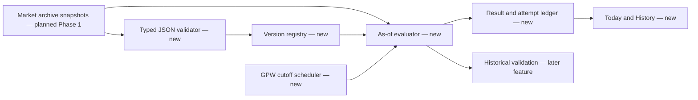
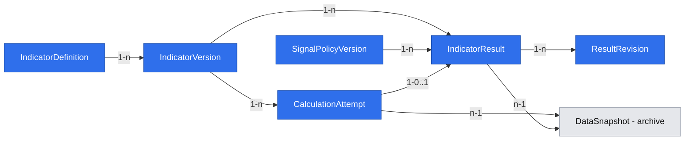

# Daily declarative GPW barometer

## 📝 TLDR

The owner needs a daily, transparent GPW market score and D03 posture before the next session. Lesine currently has no running application or indicator engine. This proposal adds one versioned JSON/DSL definition, a shared deterministic evaluator and a local Today/History view; a result is published only when all required source, coverage and timing gates pass.

## 📝 Problem Statement

The confirmed [App Spec](2026-11-04-app-spec-lesine.md) defines the first v0 formula, ten posture bands and the 08:30 Europe/Warsaw cutoff, but these rules are not yet executable. The owner needs to see a reproducible score or an explicit blocked state for each eligible GPW session, including the exact definition, source snapshot and correction history. The score is a research index, not a calibrated probability or an instruction to trade.

The local GPW archive is specified separately in [Local GPW history with coverage](2026-11-04-local-gpw-history-with-coverage.md). This feature consumes its point-in-time snapshots; it does not reimplement ingestion. Daily copper and other provider bindings require real source samples and rights checks before activation.

## 📝 Proposed Solution

The Indicator research module will validate and store immutable formula and signal-policy JSON versions. Its generic, typed operator set will express the accepted five-factor formula, including historical Main Market breadth and prior-252-session ranks, with no per-indicator calculator code. The after-close job will evaluate the active version against only data available at the cutoff, then publish the score and D03 band or record a precise blocked reason. Today and History will show the result, freshness, versions and later corrections.

This feature delivers daily indicator calculation and display. Historical portfolio validation and its separate JSON backtest protocol remain in the third feature spec.

## 📝 Research and design choices

- [OpenBB standardizes provider outputs](https://docs.openbb.co/odp/python/developer/standardization) so provider-specific fields do not leak into consumer models. Lesine applies the same principle: a definition names logical series and units, while versioned bindings identify the actual provider series. The full OpenBB plugin framework is unnecessary for the local first release.
- [QuantConnect's universe history](https://www.quantconnect.com/docs/v2/research-environment/universes) preserves membership by date to avoid selecting only today's surviving securities. Lesine's breadth must use the historically eligible Main Market shares, including those delisted later; a current ticker list cannot substitute.
- [FRED's real-time periods](https://fred.stlouisfed.org/docs/api/fred/realtime_period.html) distinguish an observation's date from when a revised value was known. Lesine retains the selected vintage/revision and available-at evidence; an observation dated before a cutoff is insufficient evidence that it was available then.
- QuantConnect's [look-ahead guidance](https://www.quantconnect.com/docs/v2/research-environment/datasets/key-concepts) motivates a single historical as-of rule. Lesine keeps that rule in the same evaluator used for daily scores and later tests. It does not need a brokerage/event-driven algorithm runtime.

## 📝 Architecture

The **Indicator research** module owns definition registration, validation, activation, calculation and results. The accepted [technology decision](research/decisions/2026-11-04-platform-technology.md) places its TypeScript evaluator in a separate NestJS worker; Angular reads results through the NestJS API. The evaluator reads the Market archive's immutable PostgreSQL snapshot interface described in [Local GPW history with coverage](2026-11-04-local-gpw-history-with-coverage.md), never calls an external data source inside an operator. A scheduler enumerates GPW sessions and creates one cutoff attempt per active indicator and session; startup reconciliation creates missed attempts after powered-off intervals, with actual publication time and `late` status. The evaluator, policy mapper and read API share one result store. The next feature's backtest invokes the same evaluator with historical cutoffs; it cannot use a separate implementation of the formula.



**Cutoff:** For GPW session `t`, the decision cutoff is 08:30 `Europe/Warsaw` on the next scheduled GPW session, using the exchange calendar, including holidays and daylight-saving transitions. The job may run earlier after close when all inputs are ready, but the on-time result's effective decision time is no earlier than its actual publication. A retry after 08:30 is marked late, even if it computes a value. No GPW session means no new result.

**Source selection:** The archive supplies a stable snapshot plus each observation's date, `available_at`, revision and provenance. The evaluator selects only values with `available_at <= cutoff`, or an explicit conservative historical availability rule when actual timestamps cannot be proven. The latter is visibly tagged `assumed_availability` and cannot be presented as observed point-in-time history. The past 252 feature values are each recomputed using their *own* historical decision cutoffs; the current cutoff must not expose revisions or observations unavailable on those past days. This rule also applies to each lag and 200-observation average.

**Freshness:** WIG and share bars must belong to session `t`; copper and USD/PLN may be no older than one GPW session; DGS2 and DGS10 may be no older than three GPW sessions. Age is measured against the GPW calendar, not wall-clock days. A nontrading US day can reuse a yield within that limit. The selected copper binding must be a verified daily market price or daily investable proxy; EODHD's monthly `COPPER` series fails the contract. All units, adjustment conventions, symbol bindings, entitlement and local retention rights are validated with a real source sample before v0 activation.

### JSON/DSL version 1

A document has `schema_version`, `name`, `cadence`, `inputs`, `universe`, `nodes`, `output_node`, `output_range` and `missing_data`. `cadence` is `gpw_after_close`; `missing_data` is `block` for v0. Each named input declares logical series, expected `unit`, `frequency`, maximum GPW-session age, and a *versioned binding reference* to an archive series. Credentials and provider fetch instructions are forbidden. `universe` declares market segment, instrument kind, dated eligibility and minimum history; this is a data query contract, not today's ticker list.

`nodes` form an acyclic graph. Version 1 allowlists only the operations needed by the accepted v0 graph: `source`, `lag`, `log_ratio`, `negate`, `subtract`, `universe_fraction`, `adjusted_close`, `rolling_sma` (inside a per-instrument predicate), `greater_than`, `prior_rank` and `weighted_sum`. Each operator has typed input/output units and calendar semantics in the schema registry; `lag` counts GPW sessions, `rolling_sma` counts valid observations for that instrument, `prior_rank` counts prior eligible GPW-session feature values. These are reusable TypeScript engine operators, not executable callbacks embedded in JSON. Version 1 has no conditionals, free-form expressions, arbitrary functions, file access or network access. Later indicators that require another operation need a new schema/engine version; this spec promises no general-purpose expression language.

The accepted v0 graph is, in canonical DSL terms:

| Node | Expression | Output |
|---|---|---|
| `wig_trend` | `log_ratio(source(WIG), lag(source(WIG), 60))` | dimensionless |
| `breadth` | `universe_fraction(main_market_ordinary_shares, greater_than(adjusted_close, rolling_sma(adjusted_close, 200)))` | fraction |
| `copper_trend` | `log_ratio(source(copper), lag(source(copper), 60))` | dimensionless |
| `pln_strength` | `negate(log_ratio(source(USDPLN), lag(source(USDPLN), 60)))` | dimensionless |
| `yield_spread` | `subtract(source(DGS10), source(DGS2))` | percentage points |
| `r_*` | `prior_rank(feature, 252, ties=midrank, include_current=false)` for each of the five features | 0–100 |
| `score` | `weighted_sum(r_wig=.30, r_breadth=.25, r_copper=.20, r_pln=.15, r_yield=.10)` | 0–100 |

The JSON representation uses flat node references and a typed predicate subtree. This is the v1 registry contract; symbolic binding ids are replaced by verified archive-series bindings at registration:

```json
{
  "schema_version": "1",
  "name": "Lesine GPW barometer v0",
  "cadence": {"kind": "gpw_after_close", "cutoff": "08:30", "timezone": "Europe/Warsaw"},
  "inputs": {
    "wig": {"binding_ref": "wig-close-v1", "unit": "index_points", "frequency": "gpw_daily", "max_age_gpw_sessions": 0},
    "copper": {"binding_ref": "daily-copper-v1", "unit": "copper_price", "frequency": "daily", "max_age_gpw_sessions": 1},
    "usdpln": {"binding_ref": "usdpln-close-v1", "unit": "PLN_per_USD", "frequency": "daily", "max_age_gpw_sessions": 1},
    "dgs2": {"binding_ref": "fred-dgs2-v1", "unit": "percent", "frequency": "daily", "max_age_gpw_sessions": 3},
    "dgs10": {"binding_ref": "fred-dgs10-v1", "unit": "percent", "frequency": "daily", "max_age_gpw_sessions": 3}
  },
  "universe": {
    "id": "main_shares",
    "market": "GPW_MAIN",
    "instrument_kind": "ordinary_share",
    "eligibility": "listed_on_session",
    "min_listed_sessions": 200,
    "min_valid_ratio": "0.90"
  },
  "nodes": [
    {"id": "wig_now", "op": "source", "input": "wig"},
    {"id": "wig_old", "op": "lag", "arg": "wig_now", "gpw_sessions": 60},
    {"id": "wig_trend", "op": "log_ratio", "args": ["wig_now", "wig_old"]},
    {"id": "copper_now", "op": "source", "input": "copper"},
    {"id": "copper_old", "op": "lag", "arg": "copper_now", "gpw_sessions": 60},
    {"id": "copper_trend", "op": "log_ratio", "args": ["copper_now", "copper_old"]},
    {"id": "usdpln_now", "op": "source", "input": "usdpln"},
    {"id": "usdpln_old", "op": "lag", "arg": "usdpln_now", "gpw_sessions": 60},
    {"id": "usdpln_trend", "op": "log_ratio", "args": ["usdpln_now", "usdpln_old"]},
    {"id": "pln_strength", "op": "negate", "arg": "usdpln_trend"},
    {"id": "dgs10_now", "op": "source", "input": "dgs10"},
    {"id": "dgs2_now", "op": "source", "input": "dgs2"},
    {"id": "yield_spread", "op": "subtract", "args": ["dgs10_now", "dgs2_now"]},
    {
      "id": "breadth", "op": "universe_fraction", "universe": "main_shares",
      "predicate": {
        "op": "greater_than",
        "args": [
          {"op": "adjusted_close"},
          {"op": "rolling_sma", "arg": {"op": "adjusted_close"}, "observations": 200}
        ]
      }
    },
    {"id": "r_wig", "op": "prior_rank", "arg": "wig_trend", "gpw_feature_values": 252, "ties": "midrank"},
    {"id": "r_breadth", "op": "prior_rank", "arg": "breadth", "gpw_feature_values": 252, "ties": "midrank"},
    {"id": "r_copper", "op": "prior_rank", "arg": "copper_trend", "gpw_feature_values": 252, "ties": "midrank"},
    {"id": "r_pln", "op": "prior_rank", "arg": "pln_strength", "gpw_feature_values": 252, "ties": "midrank"},
    {"id": "r_yield", "op": "prior_rank", "arg": "yield_spread", "gpw_feature_values": 252, "ties": "midrank"},
    {
      "id": "score", "op": "weighted_sum",
      "terms": [
        {"arg": "r_wig", "weight": "0.30"},
        {"arg": "r_breadth", "weight": "0.25"},
        {"arg": "r_copper", "weight": "0.20"},
        {"arg": "r_pln", "weight": "0.15"},
        {"arg": "r_yield", "weight": "0.10"}
      ]
    }
  ],
  "output_node": "score",
  "output_range": ["0", "100"],
  "missing_data": "block"
}
```

`adjusted_close` is valid only in a per-instrument predicate. `prior_rank` always excludes the current feature value in schema v1; it has no flag that can enable leakage. The policy version is a separate JSON document of ordered intervals, posture labels and allocations. Canonicalization sorts object keys, preserves numeric values as exact decimal strings and hashes schema version, definition, bindings, timing/coverage policy and engine version. A version's hash never changes after registration. A later operator or semantic change requires a new engine/schema version with the old evaluator retained for saved results.

Validation rejects duplicate/unknown node ids, cycles, unknown operations, missing bindings, incompatible units/frequencies, nonpositive prices for logarithms, negative or unbounded lookbacks, ranks with current-session leakage, weights not summing to 1, output outside 0–100, and any cadence other than after-close. It computes a maximum dependency horizon before activation and checks that it is bounded by configured engine limits; a high-cost definition cannot consume the whole archive accidentally. Invalid registration returns field-level errors and does not activate anything. JSON schema validation alone is insufficient: semantic validation checks the graph and available source metadata.

**Breadth denominator:** Select ordinary shares listed on the Main Market on session `t`, including later-delisted shares. Exclude NewConnect, funds, bonds, rights and other classes. Shares with fewer than 200 historical listed sessions are reported separately as warm-up, outside the denominator. Among shares with 200 listed sessions, at least 90% must have a valid split-adjusted close and trailing 200-observation SMA; otherwise block the feature. Report eligible, warm-up, valid, missing and above-SMA counts. Do not silently shrink the expected universe when a bar is absent or an identity is ambiguous. `breadth = above / valid` only when `valid > 0` and the coverage gate passes. Split-adjusted data must reference recorded corporate actions; a correction changes the snapshot.

**Rank and score:** For each raw feature at `t`, take its 252 preceding eligible GPW-session feature values, excluding `t`. Use `100 × (count(previous < current) + 0.5 × count(previous = current)) / 252`. A session is eligible for a component's reference set only if that component could be computed under its own cutoff and quality rules. If fewer than 252 values exist, the score is unavailable with `insufficient_history`; do not shorten the window or substitute a modern value. Each component rank and the weighted score retain decimal precision; UI rounding never determines a D03 band.

**D03 policy:** A separate immutable `SignalPolicyVersion` maps the *unrounded* score to exactly one of ten bands. The initial policy is the approved [D03 table](2026-11-04-app-spec-lesine.md): `[0,35)→20%`, `[35,40)→30%`, `[40,45)→40%`, `[45,50)→50%`, `[50,55)→50%`, `[55,60)→60%`, `[60,65)→70%`, `[65,70)→80%`, `[70,75]→90%`, `(75,100]→100%`. The labels, including the two texts about speculative holdings, are display copy, not portfolio operations. A policy document validates full, nonoverlapping coverage of 0–100 and percentages in 0–100. Changing a band creates a new version; it never relabels an old result.

## 📝 Data Model

The App Spec owns the domain entities `IndicatorDefinition`, `IndicatorVersion`, `SignalPolicyVersion` and `IndicatorResult`. This feature persists them and adds two internal audit records: `CalculationAttempt` for every scheduled/manual run and `ResultRevision` for lineage between published corrections. The archive's `DataSnapshot` is referenced, not owned here.



| Record | Fields and constraints | Purpose |
|---|---|---|
| `IndicatorDefinition` | id, name, purpose, created_at; name unique for owner | Stable identity across JSON revisions. |
| `IndicatorVersion` | id, indicator_id, schema_version, canonical_json, definition_hash, engine_version, effective_from, status, created_at; unique hash per indicator | Immutable validated definition. Activation periods may not overlap for one indicator and session; future effective dates are allowed. |
| `SignalPolicyVersion` | id, canonical_json, policy_hash, effective_from, created_at; immutable | Exact D03 or later mapping. |
| `CalculationAttempt` | id, indicator_id, version_id, policy_id, session_date, cutoff_at UTC, started_at, finished_at, nullable snapshot_id, status, reason_code, detail_json, `availability_evidence`; unique scheduled key for idempotency | Distinguishes pending, published, blocked, late, failed and insufficient-history outcomes. A manual retry is a new attempt linked to the scheduled one. |
| `IndicatorResult` | id, version_id, policy_version_id, engine_version, session_date, snapshot_id, revision_id, score_decimal, component_values_json, posture_band, allocation_pct, calculated_at, published_at, timing_status; unique `(version_id, session_date, revision_id)` | Immutable published calculation with complete lineage. An old result remains readable. |
| `ResultRevision` | prior_result_id, replacement_result_id, reason, detected_at, affected_source_revisions; unique replacement_result_id | Explicit correction chain. A replacement does not erase the original and is labeled late for actionable-history purposes. |

Definitions, attempts, results and canonical source histories reside in PostgreSQL; original provider responses remain in checksummed local files. The snapshot reference is an immutable PostgreSQL revision set sufficient to reproduce the value without copying all observations into each result row. Transactions publish an attempt and result atomically. A worker crash before commit leaves no half-result; replay by the same key is idempotent. Definitions and results contain no provider credentials.

## 📝 API Contracts

All routes are loopback-only and owner-scoped. The selected framework may adjust route spelling, but must keep these contracts and error semantics:

| Operation | Request | Response and validation |
|---|---|---|
| `POST /api/indicators` | name, purpose | Indicator id; duplicate name is a field error. |
| `POST /api/indicators/{id}/versions` | JSON definition | Validated immutable version id/hash or field-path errors; no activation on error. |
| `POST /api/indicators/{id}/versions/{version}/activate` | effective GPW session, policy version | Checks verified bindings, source sample, full D03 policy, nonoverlapping active interval and after-close schedule; atomically activates or returns reasons. |
| `GET /api/indicators/{id}/versions/{version}` | — | Canonical JSON, hash, schema/engine version, bindings and status, without credentials. |
| `POST /api/indicators/{id}/calculate` | session date, optional declared correction reason | Idempotent attempt reference; on-time, late, blocked or failed state. Manual calculation cannot forge an earlier publication time. |
| `GET /api/today` | — | Last GPW session, scheduled cutoff, current attempt state, result if published, reasons and source freshness. |
| `GET /api/indicators/{id}/results` | date range, optional version, include revisions | Paginated results and blocked sessions; stable result/revision ids. |
| `GET /api/indicators/{id}/results/{result}` | — | Score components, universe counts, exact versions, snapshot/revision refs, timing/availability evidence and correction chain. |

Error codes are stable machine values: `invalid_definition`, `unverified_binding`, `insufficient_history`, `missing_input`, `stale_input`, `breadth_coverage`, `unknown_availability`, `source_revision`, `engine_failure`. The response includes a human-readable Polish explanation, but never invents a numeric score for a blocked session.

## 📝 UI/UX

**Today `/`:** session date; one prominent score, posture and suggested equity allocation; actual publication time and on-time/late badge; five component contributions and freshness; a clear link to input/version details. The score is labeled “indeks stanu rynku (0–100)”, with a concise “nie jest prawdopodobieństwem wzrostu” explanation. Before the first complete session, show `insufficient_history` and earliest potentially calculable date. At 08:30 a missing source becomes an explicit blocked state with the missing series and next retry status. A late result may be inspected but must never be represented as a signal that was actionable at the earlier opening.

**History `/history`:** daily score line with D03 bands and gaps, not a joined line across blocked sessions; per-session state, version, cutoff and correction marker. Selecting a date opens input observation dates/availability evidence, counts for breadth, component ranks, hashes and correction chain. A version detail shows the canonical JSON read-only. Registering a new JSON version may use a local import/text form with schema errors by path; there is no visual formula builder in v1. Status and band information must be text-accessible, not color alone; tables and controls are keyboard usable.

## 📝 Edge Cases & Failure Scenarios

- **Provider unavailable or entitlement absent:** archive reports the missing series; activation fails with `unverified_binding`. Existing definition/results stay readable. Do not ask for an EODHD purchase until a source sample identifies which plan or alternate source is actually needed.
- **Monthly copper or wrong unit:** binding validation fails; no v0 activation. The binding cannot be “fixed” by silently changing the copper factor to monthly data.
- **Source not yet published by 08:30, including US holiday:** apply declared age limit. If exceeded, record `missing_input` or `stale_input` and show exactly which source prevented the score.
- **Historical available-at unknown:** use only a recorded conservative assumption and mark it; if no defensible rule exists, block an asserted point-in-time result. Historical validation must disclose the assumption.
- **Breadth identity/coverage uncertain:** exclude no expected share just to improve coverage; show valid/missing/warm-up counts and block below 90%.
- **Score near 75 or another boundary:** map the exact unrounded decimal; 75 is in 70–75, values above 75 are ultra offensive. Rounding is display only.
- **Corrections and retries:** archive revision creates a new snapshot and result revision; keep original publication time and content. A correction after cutoff cannot alter the earlier actionable signal used by a point-in-time test.
- **Duplicate scheduler run, daylight-saving shift or process restart:** unique scheduled key prevents duplicate publication; cutoff is derived from the exchange calendar and `Europe/Warsaw` time zone, then stored as UTC.
- **Mac powered off at cutoff:** on startup, enumerate missed eligible sessions, retain the scheduled 08:30 cutoff as the as-of boundary, and record actual calculation/publication time. Show late or blocked status; never treat a late result as available for the missed session's open in a historical test.
- **Engine crash or invalid JSON:** transaction leaves no partial score. Record a failed attempt and preserve the last published result with its original session/version label.

## 📝 Risks & Impact Review

The DSL schema/operator semantics, score precision and as-of rules are durable contracts. Persist engine version and canonical definition; keep old evaluators or migration adapters for saved results, and make new semantics opt-in through a new version. A future provider substitution changes a binding version and forces a new indicator version plus fresh source validation; it does not relabel prior results. Local PostgreSQL backup precedes schema migrations; rollback reactivates a prior immutable version for *future* sessions and leaves old results untouched. Snapshot deletion is forbidden while a result refers to it. No external order, brokerage or credential exposure is in scope.

The main feasibility risk is factual: a licensed, daily copper series and reliable timing/coverage may not be available. This is an activation gate, not evidence that the model performs well. Predictive value is evaluated only in the later historical-validation feature with its separate JSON protocol and untouched holdout. The app must work as a transparent archive/blocked-result view even if the v0 barometer cannot yet activate.

## 📝 Decisions in play

The confirmed App Spec and product brief supply D01 (one barometer first), D02 (broad Polish market), D03 (ten bands), D04/R02 (after-close), D05/R03 (score, not probability), R01 (point-in-time inputs), and N01–N02 (no trading or proprietary-formula copy). This spec proposes no superseding product decision. The product brief's older Q01/Q04 are resolved in the App Spec; Q03's provider facts remain an evidence gate. Q02 belongs to the historical-validation feature.

## 📋 Phasing

1. **Definition and policy registry:** the owner can register, validate and inspect the v0 JSON and D03 policy on a working local app; invalid definitions cannot activate.
2. **Daily evaluation and ledger:** with verified archive inputs and the local Mac running, the worker computes or explicitly blocks each eligible session at its cutoff, retaining versions, snapshot and correction history. On startup it reconciles missed powered-off sessions and labels post-cutoff results late or blocked.
3. **Today and History:** the owner can interpret results, gaps, freshness and revisions through the local browser UI.

## 📋 Implementation Plan

1. Add immutable `IndicatorDefinition`, `IndicatorVersion` and `SignalPolicyVersion` persistence plus canonical hashing; verify a second version cannot mutate the first and a D03 policy covers each boundary exactly once.
2. Add JSON schema and semantic graph validation with the bounded typed operator registry; verify cycles, unknown ops, unit mismatches, unbounded lookbacks and bad weights fail with field paths while valid alternative weights register without code changes.
3. Add archive snapshot reader and historical GPW-session cutoff planner; verify a late observation, revised vintage and daylight-saving/holiday case select only valid as-of data.
4. Implement generic scalar time-series operators and prior-rank evaluation; verify the 60/252 lookbacks, midrank ties, complete-history requirement and exact decimal score on fixed fixtures.
5. Implement dated Main Market universe selection and generic per-instrument SMA/fraction operator; verify delisted inclusion, NewConnect exclusion, warm-up counts, split adjustment and the 90% coverage gate.
6. Wire the accepted v0 graph and D03 policy through the same evaluator; verify known component calculations and all ten boundary bands, including exactly 75.
7. Add scheduled cutoff attempts, startup reconciliation, idempotent publication, blocked reasons and crash-safe PostgreSQL transaction; verify every GPW session while the Mac is running is published or accounted for as blocked at 08:30, while a powered-off interval is marked missed then reconciled as late or blocked without backdating.
8. Add source-revision invalidation and immutable correction lineage; verify original and replacement snapshots/results can both be inspected and the historical actionable result remains the one actually known then.
9. Build Today and History with version, freshness, breadth and correction detail; verify navigation, Polish labels, keyboard access and non-color-only status on published and blocked sessions.
10. Perform an account-level source sample for daily copper, WIG/Main Market bars, USD/PLN and FRED yields, including rights, frequency, units, historical coverage and availability evidence. Record the result in the local coverage report; activate v0 only when the gates pass. If access is unavailable, ship the registry and honest blocked state without claiming a live score.
11. Run an end-to-end replay of a small sequence with an outage and a corrected bar, then confirm deterministic hashes, scores and UI lineage across restart. This verifies the phase's operational acceptance; it does not validate investment performance.
