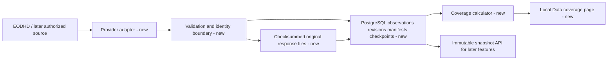
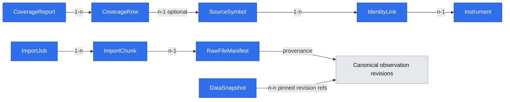

# Local GPW history with coverage

**Status:** Ready. The owner accepted the low-fidelity `/data` screen reference on 2026-11-04. External source access remains a Phase 1 evidence gate, not proof that historical data are already available.

## 📝 TLDR

The owner needs a local archive of all available GPW Main Market and NewConnect history, including later-delisted shares, with a report of source gaps. Today this repository has no application or data import. The proposed feature adds a resumable source boundary, immutable raw observations and a coverage view as the foundation for the approved barometer.

## 📝 Problem Statement

The approved [App Spec](2026-11-04-app-spec-lesine.md) requires locally retained history from each GPW market's beginning where sources have it. Full historical coverage is an acquisition target; provider availability, later delistings, corporate actions and point-in-time identity must be visible as evidence or gaps. The owner explicitly chose this broader archive even though the first indicator uses only a subset. See [feature brief](briefs/2026-11-04-lesine-gpw-history.md), WF1 and US-1.1–1.3.

## 📝 Proposed Solution

Import active and delisted instrument catalogs, daily bars and actions through source adapters into local raw storage with durable checkpoints. Retain provider revisions and dated instrument identities, then display acquired ranges and import state by market and data class. A failed batch does not erase completed work. When a rename cannot be proven, preserve both source identities and show the gap; this follows the approved App Spec's provenance rule and is not a new product choice. Provider entitlements and actual history depth are acceptance evidence, not assumed capabilities.

The first adapter targets EODHD's Warsaw (`WAR`) active and `delisted=1` symbol lists and EOD/corporate-action endpoints. NewConnect classification and historic index membership are **not** inferred from the `WAR` code; they require verified source metadata or a second authorized source. The source inventory records `unclassified` and `unavailable` states until then. Actual paid-plan coverage is checked against a small source sample before the full import, and the owner sees the result. The data-access adapter is replaceable; a source substitution does not change archive identities or erase existing data.

### Research against existing systems

- [OpenBB's provider standardization](https://docs.openbb.co/odp/python/developer/standardization) separates shared output fields from provider-specific fields and validates transformed data. Lesine needs that boundary so an EODHD `WAR` row and a later GPW source can be compared without treating their symbols as the same identifier. It does not need OpenBB's full provider/plugin runtime for one local app.
- [QuantConnect LEAN](https://www.quantconnect.com/docs/v2/writing-algorithms/securities/asset-classes/us-equity/corporate-actions) treats splits, dividends, symbol changes and delistings as distinct events; its [data normalization guidance](https://www.quantconnect.com/docs/v2/writing-algorithms/securities/asset-classes/us-equity/requesting-data) shows why raw and adjusted prices must not be conflated. Lesine keeps raw provider values and events, leaving point-in-time derived adjustments to a later indicator/test feature. It does not implement LEAN's trading engine.
- [PostgreSQL partitioning](https://www.postgresql.org/docs/current/ddl-partitioning.html) supports range-partitioned history tables when real volume and query measurements justify them. The canonical observations and revisions remain relational; original provider responses are retained in immutable checksummed files.

## 📝 Architecture

The accepted [technology decision](research/decisions/2026-11-04-platform-technology.md) selects an Angular browser UI, loopback-only NestJS API and separate NestJS import worker, PostgreSQL canonical history/metadata, and Docker Compose for local operation. A provider adapter fetches bounded batches and validates normalized rows. It writes each original provider response to a private checksummed file, then commits its manifest, import checkpoint and append-only normalized observation revisions in PostgreSQL. Queries read only committed revisions, with manifest references to their source payloads. The database schema and recovery behavior below are the contract.

The built Angular UI and `/api` share one loopback origin. Compose keeps PostgreSQL and the worker on its private network with no host-published ports; database and response-file volumes survive restart. This preserves the same-origin API/CSRF contract below.

The archive owns source provenance; downstream indicators request a named snapshot, never raw provider credentials. One worker may own an import at a time for the same provider/scope. PostgreSQL is the durable job arbiter: a worker claims a queued job under a row lock, writes a random lease token and expiry, and renews the lease while working. On startup or lease expiry, a worker resumes the same job from committed chunks. Every chunk-commit transaction checks the current lease token while locking the job row, so an expired former worker cannot publish data after another worker has claimed it. A partial unique index prevents a second active job for the same provider/scope. Different source scopes may run sequentially in the first version to keep quota and manifest ordering deterministic.

## 📝 Data Model

All nodes are proposed for Lesine; none currently exist in repository code. This Mermaid diagram is the current data-model view.

The approved App Spec §1.4 owns `Instrument`, `InstrumentIdentity`, `DailyBar`, `CorporateAction`, `IndexMembership`, `DataSeries`, `Observation`, `DataSnapshot` and `CoverageReport`. This feature adds local persistence records:

| Record | Fields and constraints | Purpose |
|---|---|---|
| `SourceSymbol` | `id` text PK; `provider` text; `provider_symbol` text; nullable `provider_instrument_id` text; `identity_evidence_ref` text; `market_segment` enum Main/NewConnect/unclassified; `instrument_type` enum; `first_seen_at` UTC; `last_seen_at` UTC; `valid_from/to` nullable dates; `delisted_flag` boolean; unique `(provider, provider_instrument_id)` only when a stable provider ID is verified; no uniqueness on ticker text alone | Preserve a vendor listing identity even when a ticker is reused by another company at a later date. Ambiguous periods remain separate with their own evidence. |
| `IdentityLink` (persistence of App Spec `InstrumentIdentity`) | `id` text PK; `source_symbol_id` FK; `instrument_id` FK; `valid_from` date; `valid_to` nullable date; `evidence_ref` text; `status` verified/superseded; unique non-overlapping verified intervals per source symbol | Join renamed symbols only with evidence. A source identity with no verified link stays unlinked and cannot enter a derived universe. |
| `ImportJob` | `id` text PK; `provider` text; `market_scope` enum; `data_classes` array; `from_date/to_date` nullable; `scope_hash` text of canonical provider/market/data-class scope (independent of requested dates); `mode` backfill/incremental; `status` queued/running/quota_wait/paused/failed/done; `cursor` text nullable; `lease_token` text nullable, `lease_expires_at` UTC nullable; `started_at`, `updated_at` UTC; `error_code` nullable; partial unique `(provider, scope_hash)` when status is queued/running/quota_wait/paused | Durable exclusive claim and resume without reimporting finished work. A failed job may resume only if no conflicting active job exists. The lease token is internal and never returned by API. |
| `ImportChunk` | `id` text PK; `job_id` FK; `resource_key` text; `from_date`, `to_date` date; `status` enum; `attempts` integer; `response_hash` nullable; `file_id` nullable; unique `(job_id, resource_key, from_date, to_date)` | One bounded request/response with idempotency and retry state. |
| `RawFileManifest` | `id` text PK; `relative_path` text; `sha256` text; `provider` text; `data_class` text; `market_scope` text; `min_date`, `max_date` date; `row_count` integer; `created_at` UTC; `schema_version` integer; exact source-observation/revision-key index | Only committed manifest rows expose original provider-response files and their associated PostgreSQL revision refs. |
| `CoverageRow` | `report_id` FK; `source_symbol_id` nullable FK; `market_segment` enum; `listing` active/delisted/unknown; `data_class` enum; `source` text; `provider_from/to` nullable dates; `acquired_from/to` nullable dates; `status` unavailable/unclassified/unknown; `gap_reason` and `evidence_ref` nullable text | Show archived data and import failures without inventing completeness. |

`DataSnapshot` adds `as_of_utc`, `archive_generation` and `availability_evidence` to the App Spec's id, creation time, revision refs and availability-rule reference. The generation and immutable revision refs fix point-in-time selection without changing any existing schema, because the application is greenfield.

Original provider responses are private local files excluded from Git; normalized observations and their revisions are canonical PostgreSQL rows. `DailyBar` keeps provider, session date, OHLCV, availability and revision; the source response's `adjusted_close` may be retained as a source field but is not the canonical raw close. A provider correction creates a new revision and response file; old revisions and manifests stay addressable for existing snapshots. A response file is written to a temporary path, validated/checksummed and atomically renamed before one PostgreSQL transaction inserts its manifest, normalized revisions and completed chunk checkpoint. A crash before commit leaves an orphan file for quarantine or cleanup; a failed transaction never exposes partial normalized rows. PostgreSQL migrations are forward-only with a pre-migration local backup, since this is a greenfield app with no previous user data.

A backup is one recoverable unit: stop API and worker writes, finish/abort open transactions, take a PostgreSQL dump and copy all referenced immutable response files into a versioned local backup bundle with a manifest of file hashes, then resume services. A restore goes into an empty database and response-file directory; verify every `RawFileManifest` path/hash before exposing coverage or snapshots. A missing or mismatched file blocks the restored archive rather than silently claiming complete coverage. Use this bundle before migrations and document the command in README.

Normalized records are idempotent **across jobs**, not merely within one `ImportJob`. A bar's source-observation key is `(provider, source_symbol_id, session_date, data_class)`; a canonical hash of the raw value/payload plus source identity becomes its revision fingerprint. Reimporting the same fingerprint creates no new bar; a changed fingerprint appends a revision with its own `available_at` and import time. Corporate actions use the analogous `(provider, source_symbol_id, action_type, ex_date, provider_event_id-or-event_fingerprint)` key; changed action content appends a revision. The App Spec's canonical `DailyBar` key uses `instrument_id` once an `IdentityLink` is verified; unresolved source observations stay source-keyed and cannot be silently attributed to an instrument. `RawFileManifest` references the exact source-observation/revision keys imported from each response, so a `DataSnapshot` can pin committed PostgreSQL revisions without scanning today's latest values.

Repeated inventory responses match a `SourceSymbol` by the stored, verified provider-issued stable instrument ID when one exists. Otherwise the importer uses the observed listing interval, delisted state and retained identity evidence; if ticker reuse or renaming makes the match uncertain, it creates or retains separate provisional source identities and a coverage gap. It never treats `(provider, ticker text)` as a permanent company key.

Credentials come from a local secret setting or process environment, are never included in request bodies, PostgreSQL, response files, logs or Git, and are never returned by the API. The service binds to loopback for the one-owner scope. If the app later becomes multi-user or public, it requires a new identity and data-licensing decision.

## 📝 API Contracts

These are local service contracts, not public internet APIs. The selected framework may alter route spelling only with an explicit same-semantics mapping. Every timestamp is ISO 8601 UTC, every market session/date is `YYYY-MM-DD`, counts are nonnegative integers, and unknown dates/counts are JSON `null`, never zero or a guessed range. A `provider` id is a registered adapter key (`eodhd` first), not an arbitrary URL.

**Access:** v1 is one owner on the local device. The process binds only to `127.0.0.1`/`::1` and rejects non-loopback `Host` values. Browser calls are same-origin; mutating requests require a per-process, random CSRF token delivered in a SameSite=Strict local session cookie and matching request header. No user-account or multi-user permission system is introduced. A missing/foreign origin or invalid token yields `403 access_denied`; a remote network request never reaches the service. Credential values are loaded from a local secret setting or process environment, never submitted in API JSON. All responses and logs omit tokens, raw provider payloads and filesystem paths. A future nonlocal/multi-user deployment requires a separate access and licensing design.

**Envelope:** successful JSON contains `data` and, for a list, `page: {next_cursor: string|null}`. Every failure has `error: {code: string, message: string, field_errors: [{path: string, reason: string}], retry_after_utc: string|null}`; `field_errors` is empty for nonvalidation failures. The UI maps stable codes to Polish text without displaying provider secrets. `400 invalid_request`, `403 access_denied`, `404 not_found`, `409 conflict`, `429 quota_wait` and `503 source_unavailable` are the common HTTP cases; provider 401/403 become sanitized `source_unavailable`, not browser authentication prompts.

| Operation | Exact request | Success `data` | Failure/validation |
|---|---|---|---|
| `POST /api/import-jobs` | JSON `{provider: string, market_scope: "main"\|"newconnect"\|"all", data_classes: nonempty unique array of "catalog"\|"daily_bars"\|"corporate_actions"\|"index_membership", mode: "backfill"\|"incremental", from_date?: date, to_date?: date}`. Dates are ordered, bounded by verified provider availability; no credential field. | `202 {id: string, status: "queued", scope_hash: string, created_at: UTC}`; job is durably queued before response. | `400` unknown/duplicate class, unsupported adapter scope or bad dates; `409` same provider/scope already active; `503` no credential/entitlement or unverified rights for a requested full import. Unsupported source classes may be recorded as unavailable coverage rather than silently dropped. |
| `GET /api/import-jobs/{id}` | UUID/text id, no query | `200 {id, provider, market_scope, data_classes, mode, status, completed_chunks: int, failed_chunks: int, total_chunks: int|null, cursor: string|null, quota_remaining: int|null, retry_after_utc: UTC|null, updated_at: UTC, error_code: string|null}`. Status is `queued/running/quota_wait/paused/failed/done`. | `404` unknown id; `403` access denied. Cursor is an opaque resume marker, never a token or raw URL. |
| `POST /api/import-jobs/{id}/resume` | Empty JSON object; id in path | `202 {id, status: "queued", cursor: string|null}`, same job and committed chunks retained. | `404` unknown; `409` not paused/failed/quota-ready, active duplicate or changed scope definition; `403` access denied. |
| `GET /api/coverage` | `market=main\|newconnect\|all`, `data_class` enum, `listing=active\|delisted\|all`, `source` registered id, `status` enum, `limit` 1–200 (default 50), opaque `cursor`; filters optional | `200 {report_id: string|null, created_at: UTC|null, summary: {provider_available: int|null, acquired: int|null, gaps: int|null}, rows: CoverageRow[]}` plus page cursor. Each row has `market_segment, listing, data_class, source, source_symbol_id|null, provider_from/to|null, acquired_from/to|null, status, gap_reason|null, evidence_ref|null`. | `400` invalid filter/limit/cursor; `403` denied. No report returns null id, unknown counts and empty rows. No global historical-completeness claim is derived. |
| `GET /api/instruments/{id}/coverage` | Canonical instrument id | `200 {instrument_id, identities: [{source_symbol_id, provider, symbol, valid_from/to, link_status, evidence_ref}], coverage: CoverageRow[], unresolved_gaps: [{data_class, reason, evidence_ref}]}`. | `404` unknown id; `403` denied. A provisional source symbol without a verified canonical link is queried through coverage rows, not misattributed to an instrument. |

**Internal snapshot reader (not an HTTP endpoint):** `create_snapshot({as_of_utc, availability_rule_ref, archive_generation}) -> {snapshot_id, created_at, source_revision_refs, availability_rule_ref}` pins only committed PostgreSQL revisions and records whether availability time is observed or assumed. `read_snapshot({snapshot_id, data_class, instrument_or_series_id, from_date, to_date}) -> ordered immutable rows [{source_identity, observation_date, value, available_at, revision_id, source_file_hash, availability_evidence}]`. Selection must not return a row first known after `as_of_utc`; an unknown `available_at` requires a named conservative rule or yields `unknown_availability`. Missing id → `snapshot_not_found`; a missing or unverified source response file for a required provenance check → `snapshot_corrupt`; a newer revision marks the old snapshot `stale` but does not change its rows. The reader never fetches a provider or mutates archive data. Later indicator tests depend on this contract.

## 📝 UI/UX

`/data` follows the confirmed App Spec §3.5 route and task direction. The owner accepted the low-fidelity screen reference on 2026-11-04 (reply “TAK” to the review request); its exact scope is the local archive coverage page and the states below. The page has import status, a start/resume control, last successful update, remaining quota/wait and a coverage table with filters for Main Market, NewConnect, active/delisted, data class and source. Selecting a gap shows why it exists and which source was checked. The table never replaces missing data with illustrative values from the screen reference.

Prototype: assets/local-gpw-history/data-coverage-wireframe.md

| State | Required visible behavior | Independent check |
|---|---|---|
| Loading | Label data as loading; any older report is explicitly timestamped/cached | Slow or fail `GET /api/coverage`; no old totals appear as current |
| Empty/first run | “Brak pobranych danych” and local credential setup instructions; no credential text field | Empty metadata store returns no report and no fabricated counts |
| Queued/running | Job id, completed/failed chunks, last update and “Dane częściowe” | Start a fixture job and observe monotone progress after reload |
| Quota wait | Retry time, remaining budget if known, retained completed chunks | Simulate provider `429`; page does not show “complete” |
| Paused/failed | Sanitized reason and last committed cursor, with Resume when legal | Interrupt import; reload and resume from checkpoint |
| Partial/unknown coverage | Acquired ranges and import evidence details, with Main/NewConnect and listing filters | Seed an unfinished NewConnect request and an unavailable index-membership class; verify filters and detail |
| API/network error | Error message and retry; prior report only with its original timestamp | Stop local service after first report; no false current success |
| Access denied | Local-access message without archive details or token | Foreign-origin request gets `403`; page does not reveal coverage |

The first release has no established design system or UI primitives in repository code; implementation chooses a small coherent local shell, form/table and HTTP-client set and records them in README before adding screen-specific components. The page uses semantic labels, keyboard-operable filters/buttons/details, focus feedback and a text/table equivalent for every color or chart status. The narrow layout stacks filters and lets rows expand, as in the reference. No synthetic market data are seeded into the production view.

## 📝 Acceptance scenarios and traceability

The following table is the contract for WF1/US-1.1–1.3 and the App Spec Phase 1 criterion. The report describes retained source identities and archived observations; an incomplete source inventory never becomes a claim about all GPW listings. The product-owner decision to remove expectation-based coverage is recorded in [the removal spec](2026-11-05-remove-expected-coverage.md).

| Requirement | Criterion | Increment / steps | Test oracle or observable behavior |
|---|---|---|---|
| US-1.1 resumable import | A repeated or interrupted import keeps committed chunks and does not duplicate identical observations | 1 / steps 2, 4–6 | Import the same fixture twice; raw revision count is unchanged. Interrupt after chunk N; restart or expired-lease claim continues from N+1. Two competing workers cannot both commit a chunk; the old lease token is rejected. `GET /api/import-jobs/{id}` and `/data` show retained progress. |
| US-1.1 quota and credential failure | No partial job is reported complete; no token appears in responses/logs | 1 / steps 1, 4–6 | Simulate missing credential, `401/403`, `429` and network failure; inspect error envelopes, job state and sanitized UI. |
| US-1.2 market/listing scope | Main Market and NewConnect plus active/delisted remain separate, even when EODHD classification is unknown | 1 / steps 2, 5–6; 2 / step 7 | Fixture has one active and one later-delisted share per market plus one unclassified WAR symbol; filters return distinct rows and preserve unclassified evidence. |
| US-1.2 retained source accounting | Every retained source identity has one coverage row per data class, with archived observations or explicit import state | 2 / steps 7–8 | Compare distinct retained source identities/classes against report rows; no missing or duplicate key. Check acquired date ranges against committed revisions. |
| US-1.2 index membership/actions | When authorized source data exist, import dated actions/membership; otherwise show an `unavailable` gap with source evidence | 2 / step 7 | One fixture with dated action/membership appears in snapshot and coverage; another with absent class returns `unavailable`, never an invented member list. |
| US-1.3 corrections and snapshots | Changed source values append a revision; old snapshot remains readable and newer snapshot reflects correction | 2 / steps 7–8 | Import revised bar/action; assert two PostgreSQL revision refs, old/new snapshot values, stale notice and no overwritten raw response file. A malformed revision leaves prior snapshot intact. |
| Local backup/restore | Database revisions and referenced original response files recover together | 1 / steps 1, 5 | Take a bundle after one committed chunk, restore into empty volumes and verify old snapshot plus file hashes; remove one copied file and assert archive readiness is blocked with the missing manifest id. |
| Local owner/data boundary | Only same-origin loopback UI may start/resume imports; data and credentials stay private | 1 / steps 1, 6 | Remote bind attempt fails; foreign Host/Origin or missing CSRF token gets `403`; no credential/raw payload in API/logs/production UI. |

## 📝 Edge Cases & Failure Scenarios

- `401/403` or missing plan entitlement: stop the affected job; leave committed chunks and previous coverage readable; show which source/class failed without printing the token.
- `429`/quota/network interruption: persist the cursor and back off according to provider response and configured budget; resume rather than restart. Do not claim successful completion on a partial import.
- Delisted or renamed symbol: enumerate active and delisted lists separately; retain source symbol history. If a reliable mapping is missing, show ambiguous/unclassified status and exclude it from a claimed complete historical universe.
- Corporate action/revised EOD row: retain old and new PostgreSQL revisions; mark dependent snapshots stale and offer a new snapshot. Never update an earlier revision row in place.
- Empty period: distinguish holiday, not-yet-listed, suspension and unknown provider gap where evidence permits; otherwise use `unknown`.
- Invalid/malformed provider payload: quarantine the chunk with sanitized diagnostic metadata; no partial normalized rows enter a committed manifest.
- Crash during file/database commit: on restart, ignore unmanifested response files, verify committed manifest checksums, and clean or quarantine orphans before resuming. The PostgreSQL transaction must commit manifest, revisions and checkpoint together.

## 📝 Risks & Impact Review

- **Provider coverage:** EODHD documents Warsaw active/delisted symbol lists, but actual Main Market/NewConnect classification, earliest records and historical index constituents need account-level sampling. The app may show gaps even after a successful import. [EODHD symbol list](https://eodhd.com/financial-apis/exchanges-api-list-of-tickers-and-trading-hours).
- **Rights and cost:** EODHD's [personal-use guidance](https://eodhd.com/help/personal-use) permits private use, and its [storage guidance](https://eodhd.com/help/storage) permits retaining downloaded data after cancellation within those restrictions. Redistribution or a later multi-user product needs a new licence. The [free EOD plan](https://eodhd.com/financial-apis/api-for-historical-data-and-volumes) exposes only the past year; deep backfill requires an entitled plan or alternate source.
- **Identity/adjustments:** automatic ticker merges or use of current adjusted prices as immutable raw history would corrupt backtests. Reversible identity links and retained raw actions keep future corrections possible.
- **Rollback:** disable a source adapter, keep its response files, manifests and PostgreSQL revisions for existing snapshots, and re-run coverage from the last valid archive generation. Do not delete historical revisions as a rollback mechanism.

## 📝 Decisions in play

- Product brief D01 (one barometer first), D02 (broad GPW market), D04 (after-session results), and R01 (point-in-time inputs) require an archive beyond current tickers. N01 (no automated trading) and N02 (no proprietary PW replica) remain unchanged.
- App Spec Phase 1/WF1 requires full available GPW history locally and a coverage report. This spec does not supersede any protected product decision.

## 📋 Phasing

1. **Source inventory and local EOD archive (steps 1–6).** Dependencies: accepted App Spec, approved `/data` screen reference, local stack/test setup, and an entitlement/retention-rights source sample before production backfill. Exit: after restart, owner can launch, inspect, pause/fail and resume an authorized catalog/EOD import; repeated fixture import is idempotent; `/data` distinguishes Main Market, NewConnect, active/delisted and `unclassified`, showing acquired EOD ranges and import status. A missing source/credential leaves a usable empty/blocked app, but this increment is not declared delivered as an archive until a real authorized sample is recorded. It does **not** claim complete corporate-action, index-membership or identity coverage.
2. **History completeness and corrections (steps 7–8).** Dependency: increment 1's durable PostgreSQL revisions/manifest, job API and EOD coverage UI. Exit: actions and dated identity/membership records are imported where verified or shown as unavailable with evidence; retained source identities remain visible; a corrected bar/action yields a new snapshot while an old snapshot remains readable; the Data page survives restart and shows import failures. This completes WF1/US-1.1–1.3 only when the authorized-source sample and rights gate have passed. No unavailable history is fabricated or global completeness asserted.

## 📋 Implementation Plan

1. **Increment 1 — local shell:** establish the Angular UI, loopback NestJS API, separate NestJS worker, Docker Compose setup, empty `/data` state, private response-file directory, PostgreSQL migrations and secret loading. Document the accepted TypeScript/UI/storage stack in README and configure real project checks in `.ai/agentic.config.json`; verify restart, same-origin/CSRF denial, no credential exposure and a passing nonempty validation gate. The empty app is usable.
2. **Increment 1 — inventory model:** add normalized source schemas, `SourceSymbol` provider-ID/evidence persistence and EODHD active/delisted inventory behind an adapter. Verify duplicate inventory, ticker reuse and unknown market classification with fixtures; the Data page shows the inventory or an explicit missing-source state.
3. **Increment 1 — early source gate:** run a bounded account-level sample for WAR Main Market/NewConnect classification, active/delisted symbols, earliest EOD/action dates, entitlement and local-retention rights **before production backfill**. Save the evidence or an explicit unavailable result in the local coverage report; do not claim full archive coverage from an unentitled or unknown source. If account access is unavailable, fixture-based development can continue but the increment cannot pass its real-data exit gate.
4. **Increment 1 — resumable jobs:** add EOD batch retrieval with configured quota budget and durable `ImportJob`/`ImportChunk` cursor. Claim jobs with PostgreSQL row lock, expiring lease and token check on each chunk commit. Verify `401/403`, `429`, interruption, two competing workers, expired-lease reclamation and restart against a fake provider; completed chunks remain and the job API/UI expose sanitized progress.
5. **Increment 1 — immutable storage:** write original responses to private checksummed files; insert normalized append-only revisions, file manifest and completed chunk checkpoint in one PostgreSQL transaction guarded by the current job lease. Provide the PostgreSQL-plus-file backup/restore bundle and verify its hashes after restore. Verify cross-job repeat imports add no duplicate, a changed bar appends a revision, and a simulated crash never exposes a partial database batch or a referenced missing file.
6. **Increment 1 — EOD coverage UI:** implement acquired EOD ranges and import evidence with the accepted `/data` states/filters, plus API contract tests. Verify active/delisted and Main/NewConnect separation, import details, keyboard path and persistence after restart; only an authorized sampled source can satisfy increment 1 exit.
7. **Increment 2 — actions, identities and membership:** add corporate actions, dated `IdentityLink` evidence, index-membership import when an authorized source supplies it, otherwise an `unavailable` coverage row; implement `DataSnapshot` create/read and stale marking. Verify split/dividend/membership fixtures, ambiguous ticker exclusion, revised bar/action old/new snapshots and missing/unknown availability errors. The existing EOD Data page remains usable.
8. **Increment 2 — source evidence acceptance:** sample actual provider depth and rights before any full backfill. Verify retained-source accounting, acquired dates, failed-request details, restart and old-snapshot access. Do not declare a full GPW archive solely from a sample or incomplete rights evidence.

## 🧪 Review

- The pre-implementation audit's R3/R4/R5 documentation gaps are addressed with an acceptance trace, typed API/snapshot contracts, explicit screen states and phase exit gates. The owner accepted the low-fidelity `/data` reference on 2026-11-04. The earlier audit report is a historical snapshot and must be rerun before implementation.
- A fresh-context scope-cohesion recheck found one archive capability with two useful increments; source-access and rights checks are acceptance constraints, not separate features.
- Scope cohesion: a fresh-context reviewer found one coherent archive capability. Its warning was applied: the first increment's coverage is explicitly EOD-specific; it does not imply corporate-action or identity completeness.
- Source identity: ticker text alone is not a durable key. The design now keeps potentially reused or renamed source identities separate until evidence supports a dated link.
- Evidence limit: public documentation supports the adapter shape and private retention rules, but actual GPW/NewConnect depth and plan entitlements cannot be verified without an account sample. This limits implementation acceptance, not the specification's intended behavior.
