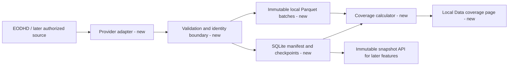
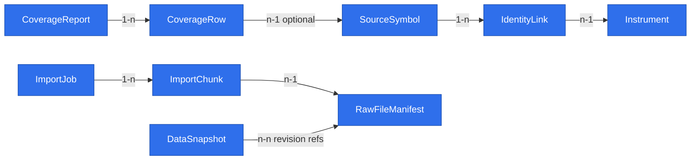

# Local GPW history with coverage

## 📝 TLDR

The owner needs a local archive of all available GPW Main Market and NewConnect history, including later-delisted shares, with a report of source gaps. Today this repository has no application or data import. The proposed feature adds a resumable source boundary, immutable raw observations and a coverage view as the foundation for the approved barometer.

## 📝 Problem Statement

The approved [App Spec](2026-11-04-app-spec-lesine.md) requires locally retained history from each GPW market's beginning where sources have it. Full historical coverage is an acquisition target; provider availability, later delistings, corporate actions and point-in-time identity must be visible as evidence or gaps. The owner explicitly chose this broader archive even though the first indicator uses only a subset. See [feature brief](briefs/2026-11-04-lesine-gpw-history.md), WF1 and US-1.1–1.3.

## 📝 Proposed Solution

Import active and delisted instrument catalogs, daily bars and actions through source adapters into local raw storage with durable checkpoints. Retain provider revisions and dated instrument identities, then display expected, provider-available and acquired ranges by market and data class. A failed batch does not erase completed work. When a rename cannot be proven, preserve both source identities and show the gap; this follows the approved App Spec's provenance rule and is not a new product choice. Provider entitlements and actual history depth are acceptance evidence, not assumed capabilities.

The first adapter targets EODHD's Warsaw (`WAR`) active and `delisted=1` symbol lists and EOD/corporate-action endpoints. NewConnect classification and historic index membership are **not** inferred from the `WAR` code; they require verified source metadata or a second authorized source. The source inventory records `unclassified` and `unavailable` states until then. Actual paid-plan coverage is checked against a small source sample before the full import, and the owner sees the result. The data-access adapter is replaceable; a source substitution does not change archive identities or erase existing data.

### Research against existing systems

- [OpenBB's provider standardization](https://docs.openbb.co/odp/python/developer/standardization) separates shared output fields from provider-specific fields and validates transformed data. Lesine needs that boundary so an EODHD `WAR` row and a later GPW source can be compared without treating their symbols as the same identifier. It does not need OpenBB's full provider/plugin runtime for one local app.
- [QuantConnect LEAN](https://www.quantconnect.com/docs/v2/writing-algorithms/securities/asset-classes/us-equity/corporate-actions) treats splits, dividends, symbol changes and delistings as distinct events; its [data normalization guidance](https://www.quantconnect.com/docs/v2/writing-algorithms/securities/asset-classes/us-equity/requesting-data) shows why raw and adjusted prices must not be conflated. Lesine keeps raw provider values and events, leaving point-in-time derived adjustments to a later indicator/test feature. It does not implement LEAN's trading engine.
- [PyArrow's Parquet documentation](https://arrow.apache.org/docs/python/parquet/parquet.html) supports columnar local files; the spec uses immutable files plus a metadata manifest rather than modifying old partitions in place.

## 📝 Architecture

One loopback-only local Python service hosts a browser UI and import worker. A provider adapter fetches batches, validates a normalized row schema, and persists the original response/checksum before writing normalized data. SQLite holds instrument identities, import checkpoints, file manifests, revisions and coverage summaries; Parquet holds immutable time-series batches partitioned by provider, data class, market scope and year. An analytical query layer reads only files listed in a committed manifest. The exact web/Parquet libraries are dependency choices during implementation; the on-disk schema and recovery behavior below are the contract.

The archive owns source provenance; downstream indicators request a named snapshot, never raw provider credentials. One process may run an import at a time for the same source/scope. Different source scopes may run sequentially in the first version to keep quota and manifest ordering deterministic.

## 📝 Data Model

All nodes are proposed for Lesine; none currently exist in repository code. [Interactive view](../data-model/2026-11-04-local-gpw-history-with-coverage.html) is a navigation aid; this Mermaid diagram is the record.

The approved App Spec §1.4 owns `Instrument`, `InstrumentIdentity`, `DailyBar`, `CorporateAction`, `IndexMembership`, `DataSeries`, `Observation`, `DataSnapshot` and `CoverageReport`. This feature adds local persistence records:

| Record | Fields and constraints | Purpose |
|---|---|---|
| `SourceSymbol` | `id` text PK; `provider` text; `provider_symbol` text; `market_segment` enum Main/NewConnect/unclassified; `instrument_type` enum; `first_seen_at` UTC; `last_seen_at` UTC; `valid_from/to` nullable dates; `delisted_flag` boolean; no uniqueness on ticker text alone | Preserve a vendor listing identity even when a ticker is reused by another company at a later date. Ambiguous periods remain separate. |
| `IdentityLink` (persistence of App Spec `InstrumentIdentity`) | `id` text PK; `source_symbol_id` FK; `instrument_id` FK; `valid_from` date; `valid_to` nullable date; `evidence_ref` text; `status` verified/superseded; unique non-overlapping verified intervals per source symbol | Join renamed symbols only with evidence. A source identity with no verified link stays unlinked and cannot enter a derived universe. |
| `ImportJob` | `id` text PK; `provider` text; `scope_hash` text; `mode` backfill/incremental; `status` queued/running/paused/failed/done; `cursor` text nullable; `started_at`, `updated_at` UTC; `error_code` nullable | Durable resume without reimporting finished work. |
| `ImportChunk` | `id` text PK; `job_id` FK; `resource_key` text; `from_date`, `to_date` date; `status` enum; `attempts` integer; `response_hash` nullable; `file_id` nullable; unique `(job_id, resource_key, from_date, to_date)` | One bounded request/response with idempotency and retry state. |
| `RawFileManifest` | `id` text PK; `relative_path` text; `sha256` text; `provider` text; `data_class` text; `market_scope` text; `min_date`, `max_date` date; `row_count` integer; `created_at` UTC; `schema_version` integer | Only committed manifest rows expose immutable Parquet files. |
| `CoverageRow` | `report_id` FK; `source_symbol_id` nullable FK; `market_segment` enum; `data_class` enum; `expected_from/to` nullable dates; `provider_from/to` nullable dates; `acquired_from/to` nullable dates; `status` complete/partial/unavailable/unclassified/unknown; `gap_reason` nullable text | Quantify source and import gaps without inventing completeness. |

Raw provider responses and normalized data are private local files excluded from Git. `DailyBar` keeps provider, session date, OHLCV, availability and revision; the source response's `adjusted_close` may be retained as a source field but is not the canonical raw close. A provider correction creates a new revision and file; the old manifest entry stays addressable for existing snapshots. A file is written to a temporary path, validated/checksummed, atomically renamed, then exposed by the SQLite manifest transaction. A crash before the manifest transaction leaves an orphan file for cleanup; a failed transaction never exposes an incomplete file. Schema migrations are forward-only with a pre-migration local backup, since this is a greenfield app with no previous user data.

Repeated inventory responses match a `SourceSymbol` by a provider-issued stable instrument ID when one exists. Otherwise the importer uses the observed listing interval and delisted state; if ticker reuse or renaming makes the match uncertain, it creates or retains separate provisional source identities and a coverage gap. It never treats `(provider, ticker text)` as a permanent company key.

Credentials come from a local secret setting or process environment, are never included in request bodies, SQLite, Parquet, logs or Git, and are never returned by the API. The service binds to loopback for the one-owner scope. If the app later becomes multi-user or public, it requires a new identity and data-licensing decision.

## 📝 API Contracts

These are local service contracts, not public internet APIs; route names can follow the selected web framework but semantics and failure states must remain.

| Operation | Input | Result | Validation/failure |
|---|---|---|---|
| `POST /api/import-jobs` | `provider`, `market_scope`, `data_classes`, `mode` | `202` with job ID and persisted queued state | `400` invalid scope; `409` same scope already running; `503` missing entitlement/credential with no job started. No token in body. |
| `GET /api/import-jobs/{id}` | Job ID | Status, completed/failed chunk counts, next cursor, quota wait and sanitized error | `404` unknown ID. |
| `POST /api/import-jobs/{id}/resume` | Paused/failed job ID | `202` same job resumed from last committed chunk | `409` already running or non-resumable definition change. |
| `GET /api/coverage` | Optional market/data-class/source filters | Latest report ID, expected/provider/acquired ranges, counts and gap statuses | Empty state when no report; never `complete` if expected universe is unknown. |
| `GET /api/instruments/{id}/coverage` | Canonical instrument ID | Source identities, dated links, data ranges and unresolved gaps | `404` unknown instrument; unresolved rename remains separate. |

The later indicator feature reads a snapshot by `snapshot_id` through an internal archive interface that returns exact revision references and known-at times. It cannot mutate archive rows.

## 📝 UI/UX

`/data` has import status, a start/resume control, last successful update, remaining quota/wait and a coverage table with filters for Main Market, NewConnect, active/delisted, data class and source. The first-run state explains how to set a local credential and begin the inventory. A partial or unknown historical range is visibly different from a complete range; selecting a gap shows why it exists and which source was checked. Keyboard access and text labels accompany status colors. No real market data is replaced with synthetic demonstration data.

## 📝 Edge Cases & Failure Scenarios

- `401/403` or missing plan entitlement: stop the affected job; leave committed chunks and previous coverage readable; show which source/class failed without printing the token.
- `429`/quota/network interruption: persist the cursor and back off according to provider response and configured budget; resume rather than restart. Do not claim successful completion on a partial import.
- Delisted or renamed symbol: enumerate active and delisted lists separately; retain source symbol history. If a reliable mapping is missing, show ambiguous/unclassified status and exclude it from a claimed complete historical universe.
- Corporate action/revised EOD row: retain old and new revisions; mark dependent snapshots stale and offer a new snapshot. Never patch earlier Parquet files silently.
- Empty period: distinguish holiday, not-yet-listed, suspension and unknown provider gap where evidence permits; otherwise use `unknown`.
- Invalid/malformed provider payload: quarantine the chunk with sanitized diagnostic metadata; no partial normalized rows enter a committed manifest.
- Crash during file/manifest write: on restart, ignore unmanifested files, verify manifest checksums, and clean or quarantine orphans before resuming.

## 📝 Risks & Impact Review

- **Provider coverage:** EODHD documents Warsaw active/delisted symbol lists, but actual Main Market/NewConnect classification, earliest records and historical index constituents need account-level sampling. The app may show gaps even after a successful import. [EODHD symbol list](https://eodhd.com/financial-apis/exchanges-api-list-of-tickers-and-trading-hours).
- **Rights and cost:** EODHD's [personal-use guidance](https://eodhd.com/help/personal-use) permits private use, and its [storage guidance](https://eodhd.com/help/storage) permits retaining downloaded data after cancellation within those restrictions. Redistribution or a later multi-user product needs a new licence. The [free EOD plan](https://eodhd.com/financial-apis/api-for-historical-data-and-volumes) exposes only the past year; deep backfill requires an entitled plan or alternate source.
- **Identity/adjustments:** automatic ticker merges or use of current adjusted prices as immutable raw history would corrupt backtests. Reversible identity links and retained raw actions keep future corrections possible.
- **Rollback:** disable a source adapter, keep its files/manifest for existing snapshots, and re-run coverage from the last valid manifest. Do not delete historical revisions as a rollback mechanism.

## 📝 Decisions in play

- Product brief D01 (one barometer first), D02 (broad GPW market), D04 (after-session results), and R01 (point-in-time inputs) require an archive beyond current tickers. N01 (no automated trading) and N02 (no proprietary PW replica) remain unchanged.
- App Spec Phase 1/WF1 requires full available GPW history locally and a coverage report. This spec does not supersede any protected product decision.

## 📋 Phasing

1. **Source inventory and local archive:** usable import of active/delisted catalogs and EOD bars with resumable jobs and EOD-specific coverage states. This increment does not claim complete corporate-action or identity coverage.
2. **History completeness and corrections:** corporate actions, dated identity links, gap details, source revisions and stale snapshot marking. Both increments leave the Data coverage page usable; Phase 2 completes WF1 acceptance.

## 📋 Implementation Plan

1. Establish the loopback local service, private data directory, SQLite schema/migrations and secret loading; verify restart does not expose credentials or lose state.
2. Add normalized source schemas, `SourceSymbol`/identity persistence and EODHD active plus delisted inventory; verify duplicate/import repeat behavior and unknown-market classification.
3. Add EOD batch retrieval with configured quota budget, durable `ImportJob`/`ImportChunk` cursor and provider error handling; verify interruption resumes after the last committed chunk.
4. Write immutable raw/normalized Parquet batches with checksums and an atomic manifest; verify a simulated crash never exposes a partial file and a correction leaves the old revision readable.
5. Build expected/provider/acquired coverage calculations and `/data` first-run/import/progress/gap states; verify an unavailable source never appears complete.
6. Add corporate actions, dated identity evidence, index-membership status and stale-snapshot marking; verify a revised bar produces a new snapshot and earlier outputs remain reproducible.
7. Run a controlled account-level sample for Main Market and NewConnect, active/delisted, actions and earliest dates; record entitlements and rights in a local coverage report before declaring WF1 complete. If a class is absent, preserve its explicit gap and source-evidence note.

## 🧪 Review

- Scope cohesion: a fresh-context reviewer found one coherent archive capability. Its warning was applied: the first increment's coverage is explicitly EOD-specific; it does not imply corporate-action or identity completeness.
- Source identity: ticker text alone is not a durable key. The design now keeps potentially reused or renamed source identities separate until evidence supports a dated link.
- Evidence limit: public documentation supports the adapter shape and private retention rules, but actual GPW/NewConnect depth and plan entitlements cannot be verified without an account sample. This limits implementation acceptance, not the specification's intended behavior.
