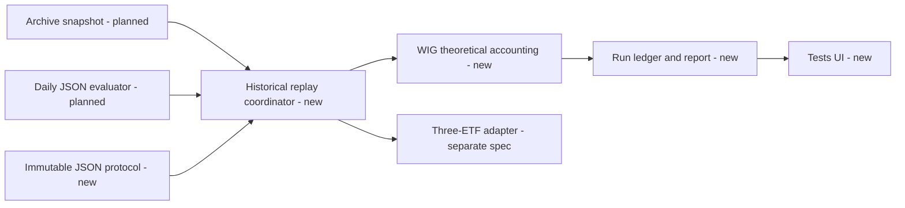
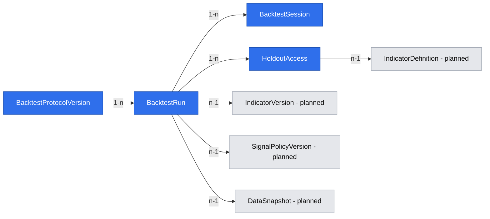

# Theoretical WIG validation

## 📝 TLDR

The owner needs to test whether v0's daily D03 allocation would have changed historical return and drawdown relative to constant WIG exposure. Lesine has no test runner today. This proposal adds a versioned JSON test protocol, point-in-time WIG simulation and a reproducible report clearly labeled theoretical.

## 📝 Problem Statement

The confirmed [App Spec](2026-11-04-app-spec-lesine.md) fixes the barometer's first formula and test defaults, but no saved test can yet show whether the allocation rule helped. A simulation that uses corrected data, prices from before a signal was available, or an unstated cash/cost rule would overstate what could have been known. WIG is an index, not a purchasable instrument.

## 📝 Proposed Solution

The Indicator research module will register an immutable JSON protocol distinct from the indicator definition. It will replay the shared daily evaluator and D03 policy at each historical cutoff, apply allocation changes at the next GPW session close, compare with constant 100% WIG exposure, and save returns, drawdown, turnover, coverage and limitations with exact version/snapshot lineage. This spec owns shared protocol/run contracts; the separate [ETF execution test](2026-11-04-three-etf-execution-validation.md) will extend the same contracts with basket holdings and prices.

## 📝 Research and design choices

- [QuantConnect LEAN](https://www.quantconnect.com/docs/v2/writing-algorithms/key-concepts/algorithm-engine) advances an algorithm's time frontier so it cannot read future bars during a backtest. Lesine must impose the same as-of boundary on its batch replay. A complete live-trading engine would exceed this local research scope.
- [Backtrader's next-bar close convention](https://backtrader.com/docu/order-creation-execution/order-creation-execution/) supports the accepted conservative end-of-day execution rule; its [cheat-on-close explanation](https://www.backtrader.com/docu/broker/) highlights why using the close that produced a signal would leak future information. Lesine models next-session close accounting, without claiming a guaranteed real fill.
- [QuantConnect's research guidance](https://www.quantconnect.com/docs/v2/writing-algorithms/key-concepts/research-guide) warns that repeatedly selecting parameters against the same out-of-sample interval undermines the test. Lesine records every protocol/definition attempt and removes the “untouched” label after that interval is viewed.
- Poland's [official statistical glossary](https://stat.gov.pl/metainformacje/slownik-pojec/pojecia-stosowane-w-statystyce-publicznej/559%2Cpojecie.html) describes WIG as an income index including dividends and rights. The theoretical test therefore uses published WIG levels as a single total-return-like series and must not add constituent dividends again.

## 📝 Architecture

The planned Indicator research module owns the protocol registry, run ledger, replay coordinator, theoretical portfolio accounting and report API. It consumes the immutable [Market archive](2026-11-04-local-gpw-history-with-coverage.md) snapshots and calls the exact JSON/DSL evaluator specified for the [daily barometer](2026-11-04-daily-declarative-gpw-barometer.md) at each historical session's own 08:30 Europe/Warsaw cutoff. It does not recalculate the five factors with a second formula. The ETF spec adds a portfolio adapter to this replay/report pipeline; it may ship later without changing the WIG test's semantics.



**As-of contract:** A score for GPW session `t` is generated with the registered indicator/engine version, policy version and archived values known by the cutoff before session `t+1`. Replay cannot read later observations, revisions or universe membership. The archive's `available_at` and FRED vintage evidence are used where known. A conservative release-lag assumption is allowed only when declared in the snapshot/rule and displayed as a timing limitation; unknown availability is never silently treated as observed point-in-time data. A historical result that was computed after the real cutoff cannot be treated as an on-time actionable result. The run records both `observed` and `assumed` timing counts.

**Eligibility:** The WIG test begins only after v0 has all 60/200/252 lookbacks and verified bindings for that session. Its start is independent of how early GPW archive data exist. WIG levels must be available for the simulated investment sessions. No ETF availability is required. A run request may select a narrower date range, but the report shows earliest valid session and all excluded/blocked dates. Missing scores cannot be filled with future data. For a restricted exploratory run, a missing daily score means hold the last allocation and report the gap; a run with such gaps cannot be labeled fully validated.

### Versioned JSON protocol

`BacktestProtocolVersion` is distinct from `IndicatorVersion` and `SignalPolicyVersion`. One immutable protocol fixes test type, benchmark, calendar, execution, costs, cash/dividend handling, signal-gap behavior, holdout and timing evidence policy. The run selects an indicator and policy version separately. The first WIG protocol has this schema-v1 shape (illustrative binding references become verified archive IDs at registration):

```json
{
  "schema_version": "1",
  "test_type": "theoretical_wig",
  "benchmark_ref": "WIG",
  "execution_rule": "next_gpw_session_close",
  "cost_scenarios_bps": [0, 10, 30],
  "cash_return_rule": "zero",
  "dividend_rule": "wig_index_level_only",
  "signal_gap_rule": "hold_and_mark_restricted",
  "availability_rule_ref": "archive-as-of-v1",
  "holdout_rule": {"kind": "latest_eligible_fraction", "fraction": "0.25", "minimum_sessions": 252}
}
```

The canonical hash covers all fields, schema and calculation-semantic version; the registry rejects missing/unknown fields, unsupported rules, duplicates in cost scenarios, negative costs, an invalid holdout, and a mismatched benchmark/test type with field-path errors. A changed cost, interval rule or benchmark creates a new protocol version. The v1 schema also admits `test_type: "three_etf_execution"` with the extra ETF fields defined in the companion spec; the same registry and run identity are reused. The portfolio weights are never embedded in the indicator JSON. The Test page shows the exact protocol version and canonical JSON.

### Simulation and measures

The initial NAV for both strategy and benchmark is 1 immediately before their first common execution close. The first usable prior-session score sets the strategy's equity allocation at that close; the benchmark targets 100%. A signal from `t` may change exposure only at **close `t+1`**, and the changed exposure first earns the **close `t+1` to close `t+2`** return. If the next GPW session or WIG close is absent, there is no simulated transaction or return for that signal. The report separates score date, decision cutoff, execution close and first affected return.

At every close, mark the pretrade equity and cash to that day's WIG level. Target equity notional is the D03 allocation times NAV; traded notional is the absolute difference between target and pretrade equity. A one-way cost scenario charges `bps / 10_000 × traded_notional` on both buys and sells, including initial entry, with a deterministic self-financing adjustment to post-cost NAV and target weights. The benchmark applies the same accounting and its own initial entry cost. Fractional index exposure is allowed only because this is theoretical. Cash earns 0% in the approved default. WIG's index methodology already reflects dividends/rights, so no separate dividend cash flow is added. Taxes, spread, market impact, borrowing, broker constraints and actual fill prices are excluded and called out.

For each cost scenario and for strategy/baseline over **identical valid dates**, report:

| Measure | Definition |
|---|---|
| Total return | final NAV / initial NAV − 1 |
| CAGR | `(final NAV / initial NAV)^(365.25 / calendar_days) − 1`; unavailable if span or NAV invalid |
| Maximum drawdown | minimum of `NAV / running_peak_NAV − 1` across daily closes |
| Turnover | sum of one-way traded notional divided by pretrade NAV, with convention and initial entry shown separately |
| Costs | total amount and percentage of initial NAV; each scenario 0/10/30 bps |
| Benchmark difference | strategy minus same-period, same-cost-scenario 100% WIG for return/CAGR/drawdown, each labeled |
| Coverage | requested, eligible, tested, blocked and assumed-timing session counts plus actual date span |

No positive return or drawdown reduction is an acceptance criterion. The first outcome is a reproducible comparison. Charts and metrics distinguish the longer WIG test from the separate, shorter tradable ETF test.

### Holdout and reproducibility

For a protocol/version/snapshot and chosen eligible period, reserve the latest 25% of eligible GPW sessions as the evaluation interval, provided that interval contains at least 252 sessions. The boundary is fixed and persisted **before** displaying performance for the reserved interval. If the minimum is not met, the run can show an exploratory report but cannot claim an untouched evaluation. Exploration on the earlier interval may compare protocol variants; all variants and their timestamps remain logged. The first time the owner opens the reserved result, the run records `holdout_revealed_at`; subsequent formula, protocol or data changes that use that same interval are labeled exploratory relative to it. The exposure ledger is keyed by the stable `IndicatorDefinition` identity and calendar interval, across WIG and ETF test types, rather than by run id alone: revealing an overlapping WIG evaluation span consumes that overlap's untouched status for a later ETF run of the same indicator. This is a platform audit of what was viewed here, not a claim that the owner had no prior market knowledge.

A run identity includes indicator-definition hash, policy hash, protocol hash, engine/calculation versions, archive snapshot id, requested date span and timing-rule id. Replaying the same identity produces bit-for-bit equivalent normalized event/metric output and returns the existing run or an explicitly linked repeat, never an overwrite. A source revision yields a new snapshot and run, while the old report remains available with a stale-source notice. Save each session's source score/result ref, target allocation, pre/post-trade NAV, trade notional, cost, benchmark NAV and gap/timing flags as immutable PostgreSQL rows linked to the run; store a hash of their canonical ordered serialization in run metadata.

## 📝 Data Model

The confirmed App Spec owns `BacktestProtocolVersion` and `BacktestRun`. This spec adds `BacktestSession` as an immutable per-session audit record and `HoldoutAccess` as a disclosure record. It references but does not own `IndicatorVersion`, `SignalPolicyVersion` or `DataSnapshot`. No existing database schema exists yet; this is the planned PostgreSQL schema under the accepted [technology decision](research/decisions/2026-11-04-platform-technology.md).



| Record | Key fields and constraints | Lifecycle |
|---|---|---|
| `BacktestProtocolVersion` | id, schema_version, test_type, canonical_json, configuration_hash, created_at; unique hash | Validated once, never mutated. The ETF spec adds typed basket configuration within the same versioned JSON contract. |
| `BacktestRun` | id, test_type, version_id, policy_version_id, protocol_version_id, snapshot_id, engine_version, period_start/end, run_identity_hash, status, session_set_hash, created_at, completed_at, limitation_flags; unique run identity hash | Pending → complete/blocked/failed; terminal metadata and session rows commit atomically; reruns/corrections are new linked runs. |
| `BacktestSession` | run_id, GPW date, score/result ref, availability evidence, target allocation, execution date, WIG level ref, pre/post NAV, trade notional, costs by scenario, benchmark NAV, gap flags; unique `(run_id, date)` | Immutable PostgreSQL rows committed with a completed run, not partial results. |
| `HoldoutAccess` | id, run_id, indicator_id, interval_start/end, revealed_at, access_kind, actor=`owner` | Append-only cross-test record of first and later display/export of reserved results. Any overlap for the same indicator removes the untouched claim on those dates, regardless of protocol or test type. |

Protocol and result rows contain no credentials. The single-owner loopback access rule from the App Spec applies. A failed worker job leaves a blocked/failed run record and no published partial performance rows. PostgreSQL commits all session rows, summary metrics and a canonical content hash with the terminal run status in one transaction. Archive revisions referenced by any run remain retained; original source-response files remain available for provenance verification.

## 📝 API Contracts

These are local service contracts; route spelling may follow the selected web framework.

| Operation | Request | Response/failure |
|---|---|---|
| `POST /api/test-protocols` | JSON v1 protocol | Immutable id/hash or field-path errors; no run starts on invalid JSON. |
| `GET /api/test-protocols/{id}` | — | Canonical JSON, hash, type, creation time. |
| `POST /api/backtests` | indicator version, policy version, protocol id, start/end dates, snapshot id | Run id/status or coverage/timing error; deterministic identity avoids duplicate execution. |
| `GET /api/backtests/{id}` | — | Metadata, version refs, range, result/limitations; reserved metrics redacted until a reveal operation. |
| `POST /api/backtests/{id}/reveal-holdout` | explicit owner action | Append-only `HoldoutAccess`, then reserved report; no second “untouched” claim for later variants. |
| `GET /api/backtests` | type/version/date filters | Saved runs, statuses, stale-source flags; no private provider token. |

The run endpoint rejects `insufficient_holdout` only as a validated-label request; an exploratory run may proceed. It blocks impossible dates, unavailable WIG bars, missing version refs, nonreproducible snapshots and unsupported execution conventions with stable error codes. Long jobs return `pending` and progress; restarts resume or fail cleanly without exposing half a chart.

## 📝 UI/UX

At `/tests`, the owner chooses a saved indicator version, D03 policy, WIG protocol, snapshot and date range. Before run, the page shows eligible period, blocked dates, assumed versus observed publication timing, cost scenarios and the planned holdout boundary. A completed report uses a prominent **“Teoretyczny test indeksu WIG”** label, two equity curves, return/drawdown/turnover comparison, a cost-sensitivity table and a disclosure that WIG itself was not purchased. Missing scores or benchmark data appear as gaps and restrictions rather than a seamless line. The reserved interval remains hidden until a deliberate reveal; the page states that revealing it ends the untouched status for later revisions. Saved runs can be compared only with their differing dates, protocol versions and source limitations visible.

Loading, blocked and failed states keep the prior reports readable. All states, costs and line series are named in text, not only color; charts have a tabular equivalent and keyboard-accessible controls. No accepted detailed UI prototype exists; this is the functional contract, not an asserted visual design.

## 📝 Edge Cases & Failure Scenarios

- **No score before lookbacks or no daily copper binding:** show earliest complete date or blocked range; do not evaluate an ad hoc shorter indicator.
- **Historical publication timestamps absent:** mark the assumption and limited point-in-time validity. If no defensible lag rule exists, block validated status.
- **Missing WIG bar or archive correction:** block affected validated period; a restricted exploratory interval must show exact gaps. Later correction creates a new run/snapshot, preserving old output.
- **Signal arrives after its decision cutoff:** it cannot set the next close's allocation. A later computed score is audit-only for that decision.
- **No next trading close at requested end:** do not invent a fill; end at the last observable close and report the unused signal.
- **Costs/holdout omitted or invalid in JSON:** reject protocol before the run with field-path errors.
- **Repeat research after holdout reveal:** retain the new variant but label its use of that interval exploratory; never restore “untouched” by renaming a version.
- **Process restart during replay:** resume from a verified checkpoint or fail with a reason; never publish partially computed metrics as complete.

## 📝 Risks & Impact Review

The highest risk is false historical precision. The point-in-time replay and cutoff evidence are part of the run identity, and every report states whether availability times are observed or assumed. A source or methodology change creates a new version and run; there is no rewrite of an old result. The WIG comparison is theoretical even with cost sensitivity. The date boundary and initial-entry cost convention matter materially and are shown to the owner. Rollback disables new runs while preserving protocols, snapshots and completed reports; schema changes require a metadata backup and a versioned migration. There is no order execution, account holding import or public sharing.

## 📝 Decisions in play

Product-brief rules R01–R03, D01–D06 and N01–N02 remain in force. The confirmed App Spec resolves its older Q02 defaults: next-session close, 0/10/30 bp, 0% cash and 25%/252-session holdout. The owner chose two feature specs for theoretical WIG and ETF execution tests; both remain inside App Spec WF3. This spec does not change the approved formula, D03 policy or product scope. The actual source quality and investment outcome remain evidence gates, not pre-decided facts.

## 📋 Phasing

1. **Protocol and replay foundation:** the owner can register a WIG JSON protocol, inspect its hash and run a bounded, point-in-time replay with explicit coverage/blocked status.
2. **Theoretical WIG report:** the owner can compare D03 exposure with fixed WIG exposure over matching dates and cost scenarios, save the audit trail and reveal the reserved interval deliberately.

## 📋 Implementation Plan

1. Persist immutable protocol versions with canonical JSON/hash and field-path validation; verify invalid cost/holdout/benchmark combinations cannot create a run.
2. Add run identity, PostgreSQL session-set hash and statuses; verify identical inputs reuse a run and a source correction creates a distinct linked run.
3. Integrate the daily evaluator in historical-cutoff mode and archive snapshot references; verify late values/revisions are excluded and timing assumptions are recorded.
4. Build GPW-session eligibility and holdout partitioning before any report is shown; verify 25%/252 minimum and a date range lacking enough history cannot claim untouched status.
5. Implement theoretical WIG/cash accounting, next-session close exposure changes and 0/10/30 bp one-way cost paths; verify initial entry, no same-close signal benefit, missing-signal restriction and benchmark date alignment on small hand-computed fixtures.
6. Compute NAV series, return, CAGR, maximum drawdown, turnover, costs and benchmark differences; verify deterministic rerun output and no dividend double count on the WIG index level.
7. Add crash-safe PostgreSQL session records and correction lineage; verify a restart never publishes a partial report and an old snapshot/report remains readable.
8. Build Tests WIG setup, progress, report, coverage and holdout reveal states; verify text/table alternatives, visible limitations and that a later variant cannot recover the untouched label.
