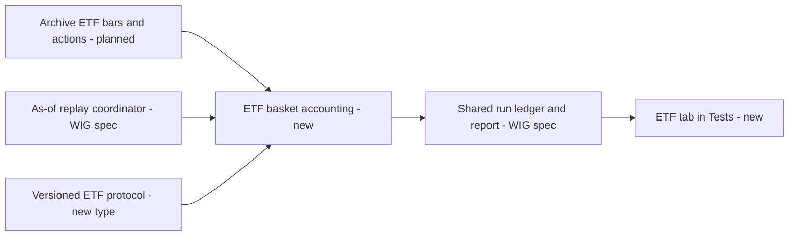
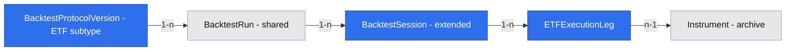

# Three-ETF execution validation

## 📝 TLDR

The owner needs a historical execution-oriented comparison using BETA ETF WIG20TR, mWIG40TR and sWIG80TR from their actual common trading period. Lesine has no ETF test runner today. This proposal extends the versioned test protocol and shared replay engine to simulate declared basket weights, cash, turnover and transaction-cost scenarios against a fixed-exposure baseline.

## 📝 Problem Statement

The theoretical WIG test cannot show the impact of tradable ETF price history, ETF start dates and portfolio rebalancing costs. A three-fund basket must not be projected backward before the last fund existed, and a result must state its execution convention and coverage.

## 📝 Proposed Solution

The Indicator research module will use the existing indicator evaluator and the protocol/run registry defined by [Theoretical WIG validation](2026-11-04-theoretical-wig-validation.md). A separate ETF protocol version will declare the three instrument ids and equity-sleeve weights, while the simulation compares D03-driven exposure with 100% exposure to that same fixed basket. The report will show price/action provenance, cost sensitivity, holdout status and limitations without claiming real fills or guaranteed investment performance.

## 📝 Research and design choices

- The [BETA ETF issuer history](https://betaetf.pl/o-nas/) places sWIG80TR's launch in 2021, after the first two funds. The actual exchange listing dates and available EOD bars still need source-level verification; a 2019 or earlier three-fund execution curve would be synthetic.
- [QuantConnect's order-model documentation](https://www.quantconnect.com/docs/v2/writing-algorithms/trading-and-orders/key-concepts) separates fills, fees and slippage. Lesine's close-price model is a research convention, so the report must distinguish observed market prices from assumed fills and cost scenarios. It does not need brokerage integration.
- [Backtrader's commission model](https://www.backtrader.com/docu/commission-schemes/commission-schemes/) charges each buy and sell as a percentage of traded value. Lesine adopts the App Spec's 0/10/30 bp one-way traded-notional sensitivity, with the same rule for strategy and baseline.
- [QuantConnect's backtest results](https://www.quantconnect.com/docs/v2/local-platform/backtesting/results) expose equity, fees and holdings alongside return statistics. Lesine should likewise show holdings, turnover and cost paths, because a headline return alone hides the mechanism of an ETF basket result.

## 📝 Architecture

This feature adds an **ETF basket accounting adapter** to the replay coordinator and run registry specified by [Theoretical WIG validation](2026-11-04-theoretical-wig-validation.md). The daily [barometer evaluator](2026-11-04-daily-declarative-gpw-barometer.md) and immutable [Market archive](2026-11-04-local-gpw-history-with-coverage.md) remain the sources of scores and price/action history. The adapter consumes a `three_etf_execution` protocol version; it does not add ETF symbols or weights to indicator JSON and does not reimplement the v0 formula.

**Instrument/date gate:** The protocol contains durable archive instrument IDs for exactly BETA ETF WIG20TR, mWIG40TR and sWIG80TR, not ticker text alone. A local source check must confirm each first trading date, currency, raw EOD prices, corporate actions and necessary volume/availability evidence. The eligible start is the first GPW session on which all three are listed and have complete required price/action history *and* the barometer score is point-in-time eligible. The exact date is measured from the archive; 2021 is only a documented launch-year clue. There is no proxy substitution or synthetic pre-listing return. If one fund's data are absent, this test is blocked; the theoretical WIG test remains usable.

### ETF protocol extension

The shared `BacktestProtocolVersion` v1 registry accepts an ETF variant with `test_type: "three_etf_execution"`. It requires the base fields from the WIG spec plus:

| Field | Contract |
|---|---|
| `basket_weights` | Exactly three records with durable `instrument_id` and positive decimal `weight`; unique IDs; weights sum exactly to 1 for the equity sleeve. The owner sets weights in each protocol; no application-wide weighting default. |
| `basket_rebalance_rule` | Explicit allowlisted value, initially `daily_constant_mix` or `on_exposure_change`; both strategy and baseline use the *same* rule so an exposure comparison does not hide different basket-maintenance conventions. No implicit default. |
| `price_rule` | `raw_etf_close_with_actions` in v1; source action/payment dates must be usable. The app does not combine an adjusted total-return series with a second dividend credit. |
| `currency_rule` | `all_pln` in v1; reject a non-PLN binding rather than assume an FX conversion. |
| `execution_rule` | `next_gpw_session_close`, inherited from the approved first test. Other fill timings require a new protocol semantic version. |
| `cost_scenarios_bps`, `cash_return_rule`, `holdout_rule` | 0/10/30 one-way basis-point scenarios, 0% default cash, latest 25% eligible sessions with at least 252; values remain explicit in the saved JSON. |

Changing weights, rebalancing rule, costs, cash or any binding makes a new immutable protocol/run. Field-path validation rejects duplicate/missing ETF ids, weights outside (0,1), sum ≠ 1, missing action rules, unsupported currencies, unverified listing dates and impossible execution settings before a validated run. The exact securities and weights are visible on every report. A protocol using one of the two rebalance rules is an explicit research choice, not an optimized result; comparing both on exploratory history consumes variants and cannot preserve an untouched label after the evaluation period has been inspected.

### Simulation and comparison

For session `t`, only a score known by the cutoff before `t+1` may set a target at close `t+1`; that target first earns return from close `t+1` to the following eligible close. The strategy targets `allocation_t × basket_weight_i` in each ETF and holds the remainder as 0%-return cash. The baseline targets `1 × basket_weight_i`. At each eligible close, mark holdings using that session's raw prices and apply recorded splits to units; credit a distribution only when its payment date and amount are established. Then follow the protocol's `basket_rebalance_rule`: `daily_constant_mix` restores target fund proportions at every eligible close, while `on_exposure_change` trades only when the allocation target changes (with the baseline's initial buy and no later signal trades). The report states that these rules yield different basket drifts and turnover; comparison always uses the same declared rule on both paths.

Trade notional is the sum of absolute buy/sell values across the three funds, not the net portfolio change. A one-way cost scenario charges `bps / 10_000 × traded_notional` on every leg, including initial entry, for both strategy and baseline. Accounting is self-financing: costs reduce NAV/cash, and post-cost target holdings are solved consistently so the report cannot spend negative cash merely to meet a requested weight. No leverage or shorts are allowed. Fractional units are a research simplification; real order sizes, spread, slippage, market impact, commissions, taxes and close-price fill availability are not measured. Fund expenses already reflected in market prices are not deducted again. A zero-volume/missing bar on a required trading day prevents a validated fill claim; the run either blocks that interval or marks a clearly restricted exploratory path with no invented trade.

The baseline holds the **same three fund weights** at fixed 100% equity exposure and the same rebalance rule, prices, action handling, costs and dates. This isolates the D03 allocation effect within the selected basket. Compare ETF strategy only against this ETF baseline, not against WIG over a different period. WIG results may appear beside it for context with distinct dates and labels, but their return difference is not presented as a controlled comparison.

The shared metrics from the WIG spec apply: total/annualized return, maximum drawdown, turnover, costs, active sessions, gaps and benchmark differences at 0/10/30 bps. Add per-fund contribution, units/weights over time, distribution/action events and missing-price/liquidity flags. The three ETF cost scenarios run on the same valid dates. There is no positive-performance acceptance threshold.

### Holdout and revisions

The same run-identity and holdout mechanism applies. The reserved interval is the latest 25% of ETF-eligible sessions and needs at least 252. Its boundary is calculated from the ETF test's own common-history period, so it will usually differ from the longer WIG interval. A view of WIG or ETF results on an overlapping reserved interval for the *same indicator/policy candidate* consumes that overlap's untouched status in both test types; the research exposure ledger is shared, not keyed only by the run type. A changed ETF weight/protocol after viewing its holdout is exploratory. Corrections to an ETF bar, split or distribution produce a new archive snapshot and run; prior reports remain readable with a source-stale marker. Unknown historical publication times must be disclosed just as in the WIG report.

## 📝 Data Model

This feature **extends** the planned `BacktestProtocolVersion` JSON subtype and `BacktestSession` record, and adds `ETFExecutionLeg` rows for per-fund audit. It reuses `BacktestRun`, `HoldoutAccess`, `DataSnapshot` and the archive's `Instrument`/corporate-action identity. There is no separate ETF run registry or duplicate signal table.

| Record | Fields and constraints | Purpose |
|---|---|---|
| `BacktestProtocolVersion` ETF subtype | Base protocol fields plus exact `basket_weights`, `basket_rebalance_rule`, `price_rule`, `currency_rule` in canonical JSON/hash | Immutable declared basket and execution convention. |
| `BacktestSession` extension | run_id/date, three price/action refs, per-fund and total pre/post values, target/actual weights, cash, total traded notional/cost by scenario, source/coverage flags | Shared immutable per-session PostgreSQL record remains sufficient to reproduce the result. |
| `ETFExecutionLeg` | run_id, session_date, instrument_id, scenario_bps, raw_close_ref, action_ref, units_before/after, target_weight, buy_notional, sell_notional, cost, available_volume_flag; unique `(run_id, session_date, instrument_id, scenario_bps)` | Shows exactly which fund generated return, trade and cost. |

Session and leg rows live in PostgreSQL with immutable run identity and a canonical ordered `session_set_hash`; the run becomes complete only when all rows and summary metrics commit atomically. A correction creates a new linked run and never rewrites completed rows. Original provider responses remain in checksummed archive files. There are no credentials or personal holdings in these records.

## 📝 API Contracts

The shared `POST /api/test-protocols` validates the ETF subtype and returns field-path errors or a canonical hash. `POST /api/backtests` accepts the ETF protocol id with the selected indicator, policy, snapshot and range; it rejects a mismatched WIG type, missing instrument history or an unknown action convention before calculation. The shared `GET /api/backtests/{id}` returns `test_type: "three_etf_execution"`, common-history start, portfolio/baseline metrics and visible limitations. A paginated `GET /api/backtests/{id}/legs` returns per-session fund prices, units, actions, trades and costs after normal holdout redaction rules; it cannot leak reserved interval rows through detail/export APIs before reveal. The shared reveal endpoint logs holdout access for this candidate across both test types. Long-running work uses the same pending/blocked/failed statuses and idempotent run identity as the WIG test.

## 📝 UI/UX

The Tests page has a separately titled **“Test koszyka trzech ETF”** mode. Before running, it shows the three resolved fund identities, user-supplied weights, earliest common eligible date, signal coverage, rebalancing rule, costs and timing evidence. A valid report shows strategy and same-basket 100% baseline curves on the *same* date axis, metrics and cost sensitivity, a table of each fund's trades/weights and a visible “ceny zamknięcia są założeniem wykonania” limitation. A missing fund or action record produces a blocked reason; the WIG report remains accessible. The reserved period remains hidden until reveal, with text explaining cross-test consumption of untouched status. Charts have tabular equivalents and accessible labels; color does not carry status alone.

## 📝 Edge Cases & Failure Scenarios

- **One ETF was not yet listed or its price series begins late:** start no earlier than the first common verified session; never splice an index proxy into the ETF test.
- **Ticker changed or two provider symbols conflict:** resolve to durable archive instrument identity with evidence; otherwise block that fund rather than joining by ticker text.
- **Split, distribution or adjusted/raw double count:** reject a conflicting price/action convention. If a distribution's payment information is required but missing, block validated status.
- **Missing/zero-volume price at a required rebalance:** do not invent a closing fill; block or label a restricted exploratory interval and show the exact date/fund.
- **Weights do not sum to one or currencies differ:** reject the protocol with field errors before a run.
- **No next-session ETF close or score arrived late:** no action on that session; record a blocked/unused signal instead of backdating.
- **Source correction or job crash:** retain previous completed run/rows and expose a new linked run or failed state; never display half-computed performance.
- **Holdout viewed through another report:** shared exposure ledger removes untouched status for overlapping dates of the same candidate, even if the ETF protocol is new.

## 📝 Risks & Impact Review

Close-price portfolio accounting is an execution-oriented **simulation**, not proof of fills or capacity in these ETFs. The chosen basket weights and rebalance rule materially affect turnover and cost; both are required JSON fields and prominent report metadata. The first common trading date, price/action integrity and any timing assumption must be verified with actual source samples before a validated report. The new ETF protocol subtype is additive; an old WIG protocol/run remains readable and runnable under its recorded semantic version. Rollback disables ETF subtype registration/runs while preserving already saved PostgreSQL records and source snapshots. No broker, order submission, tax model or outside user is added.

## 📝 Decisions in play

The same product-brief rules R01–R03, D01–D06 and N01–N02 apply. The confirmed App Spec specifies an ETF basket with protocol-defined weights and a same-basket 100% baseline; it does not specify global weights. The owner chose separate specs for WIG and ETF tests while keeping both outputs in WF3. The basket's actual listing dates and trading coverage are factual activation gates, not product decisions. This spec does not supersede the accepted v0 formula or D03 policy.

## 📋 Phasing

1. **ETF protocol and history gate:** owner can register an explicit three-fund protocol and see verified common-history/coverage status; the WIG test continues to function.
2. **ETF simulation and comparison:** owner can run a reproducible price-based ETF basket test, inspect holdings/costs and compare it with the same-basket fixed-exposure baseline, or see a precise blocker.

## 📋 Implementation Plan

1. Extend the shared protocol validator with exactly-three durable ETF identities, decimal weights, explicit rebalance/price/currency rules and no global defaults; verify malformed baskets never register.
2. Add ETF listing, price, action and volume coverage gate using archive snapshots; verify pre-listing dates and ambiguous symbol identity block only ETF runs.
3. Extend the shared PostgreSQL session records with per-fund price/action and holding state plus `ETFExecutionLeg`; verify a corrected bar/action makes a new run without rewriting the old one.
4. Implement raw-price/action accounting and the two declared rebalance rules with 0/10/30 bp one-way cost paths; verify exact next-session-close timing, cash conservation, buy/sell costs and no dividend or expense-ratio double count on hand-computed fixtures.
5. Compute strategy and same-basket 100% baseline over identical common sessions; verify a fund gap or zero-volume needed trade cannot appear as a validated fill and WIG metrics remain unaffected.
6. Apply shared holdout/research exposure ledger across WIG and ETF reports; verify revealing overlapping WIG dates removes the untouched label from a later ETF variant.
7. Add ETF setup, progress, blocked and report UI with cost sensitivity and per-fund audit; verify exact weights/rule/date span are visible, holdout detail is redacted before reveal, and charts have accessible tables.
