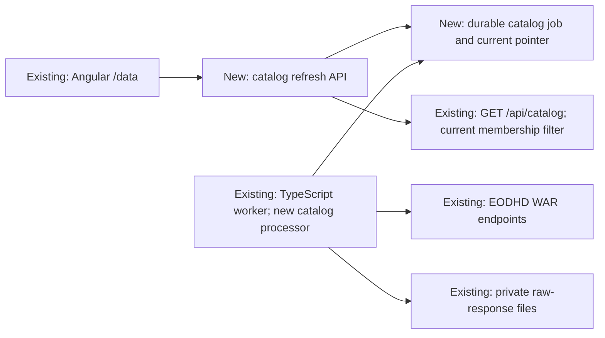
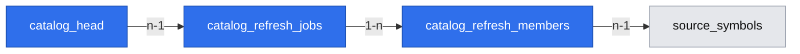

# Pobieranie katalogu EODHD z ekranu danych

## 📝 TLDR
Właściciel Lesine widzi lokalne tickery na `/data`, ale dziś pobiera katalog tylko poleceniem workera. Proponowana zmiana pozwala uruchomić pobranie z tego ekranu, obejrzeć zapisaną listę i świadomie potwierdzić jej ponowne pobranie, gdy jest niepusta. Nowa lista staje się bieżąca dopiero po poprawnym pobraniu obu części EODHD; historia źródła i notowania pozostają dostępne.

## 📝 Problem Statement
Issue #18 opisuje przeszkodę w pierwszym uruchomieniu: przy pustym katalogu przycisk importu EOD jest nieaktywny, a pobranie listy wymaga CLI. Użytkownik chce unikać zbędnych wywołań EODHD, więc musi zobaczyć lokalny katalog przed ponownym pobraniem i potwierdzić zastąpienie bieżącej listy.

## 📝 Proposed Solution
Dodać akcję i stan zadania katalogowego na istniejącym ekranie `/data`. Zakres pobrania to dokładnie dwa pełne zapytania `exchange-symbol-list/WAR`: aktywne oraz `delisted=1`; nie jest to inwentaryzacja innych giełd ani potwierdzenie pełnego rynku GPW. Zachować istniejącą tabelę tickerów. Worker pobiera aktywną i wycofaną listę WAR, sprawdza je i atomowo publikuje nową wersję bieżącego katalogu. Ponowne pobranie wymaga potwierdzenia w UI i jawnej deklaracji po stronie API; anulowanie nie tworzy zadania.

## Resolved assumptions (autonomous defaults)

| # | Question | Applied default | Why | Confirm? |
|---|---|---|---|---|
| Q1 | Czy ograniczyć listę WAR do rodzaju `common_stock`? | Nie: zapisać wszystkie rodzaje instrumentów zwrócone przez dwie listy WAR i zachować `instrument_type`; w UI mówić o tickerach/instrumentach, nie deklarować, że każda pozycja jest spółką. | Tak działa obecny normalizator i katalog jest potrzebny także dla ETF; filtr typu można dodać później bez utraty danych. | Reversible; owner may override before merge. |

## 📝 Evidence and design choice

- Verified in code: `apps/web/src/app/data.ts` already renders the paginated ticker table and disables the one-year EOD action when `count=0`; `apps/api/src/catalog.controller.ts` exposes only `GET /api/catalog`; `apps/worker/src/probe.ts` is the current manual entry point. `probeCatalog` in `apps/worker/src/catalog.ts` also runs depth samples, so the new UI action must call only the catalog part.
- EODHD documents separate active and `delisted=1` WAR lists; both calls are needed for this inventory. Its published limit page classifies each exchange-symbol-list request as one daily call and documents HTTP 429 with `Retry-After`: [symbol-list API](https://eodhd.com/financial-apis/exchanges-api-list-of-tickers-and-trading-hours), [limits](https://eodhd.com/financial-apis/api-limits). Account entitlement remains unverified (product brief Q03/Q06).
- [Airbyte's sync modes](https://docs.airbyte.com/platform/using-airbyte/core-concepts/sync-modes) distinguish a current source view from retained history. Lesine needs an atomic current pointer while keeping source identities and raw evidence; it does not need a general replication framework. [OpenBB's provider standardization](https://docs.openbb.co/odp/python/developer/standardization) supports keeping provider-specific identifiers distinct; Lesine already does this in `normalizeCatalog`.

## 📝 Architecture

The API only queues or reads a job; it never calls EODHD or receives a provider token. The worker claims one catalog job at a time using the existing PostgreSQL lease pattern from `apps/worker/src/import-jobs.ts`. It uses the existing normalizer, raw-file retention and `source_daily_budget` reservation from `apps/worker/src/catalog.ts`, but the catalog-only path never calls EOD/dividend/split depth endpoints. No catalog request runs on application startup. A previously queued user-initiated job may resume after worker restart.

Fetching and publication are distinct. For each of the active and delisted lists, the worker reserves budget **before** the provider request; a validated response is retained by hash and checkpointed on the job so a retry does not need to ask for that part again. After both parts are present, it verifies combined uniqueness, stores identities and membership, then swaps the current-catalog pointer and marks the job done in **one PostgreSQL transaction**. Until commit, `GET /api/catalog` continues to show the old list. Orphaned raw files after a crash are harmless and may be reconciled by existing archive-file maintenance.

The current EOD import builder in `apps/api/src/import-jobs.controller.ts` enumerates all `source_symbols`. For **new** import jobs it must enumerate the published current membership, including delisted rows, while retaining a legacy fallback before the first new publication. Chunks already queued or imported continue to reference their original identities. This avoids importing tickers removed from the current provider response while preserving the historical archive. The source scope remains `unclassified` unless independently verified; a successful provider list is not proof of complete GPW coverage.

## 📝 Data Model

Add migration `db/migrations/005_catalog_refresh.sql` using the repository's forward-only migration convention:

- `catalog_refresh_jobs`: UUID id; provider `eodhd`; status `queued|running|quota_wait|failed|done`; `origin` `eodhd_war_pair|legacy`; created/updated/published timestamps; nullable active/delisted response hashes and row counts; sanitized `error_code`, `retry_after_utc`; lease token/expiry. Enforce one active user catalog job for the provider with a partial unique index. Retain completed jobs as provenance of publication.
- `catalog_refresh_members`: `(job_id, source_symbol_id)` primary key with FKs to the job and `source_symbols`. It records which identities were present in each **successfully published** catalog. A job's staged hashes do not make its members visible.
- `catalog_head`: one row per provider pointing to the published job. It changes only in the publication transaction.

Migration seeds a `legacy` head and membership from all existing `source_symbols` when they exist. This preserves the visible list and confirmation requirement immediately after upgrade, without asserting that the legacy set is a complete EODHD response. An empty pre-upgrade database has no head. Do not delete or rewrite `source_symbols`, `catalog_probes`, import chunks, EOD revisions, or response files. Archive backup/restore must include the new tables automatically and a pre-migration bundle remains the rollback path.

## 📝 API Contracts

All routes stay under the existing `/api` prefix, use the current JSON envelope, and are protected by `apps/api/src/local-access.ts` and CSRF for POST. No endpoint accepts or returns a provider token or raw provider response.

| Operation | Request and response | Rules |
|---|---|---|
| `GET /api/catalog` | Keep existing filters and pagination. Add `current_catalog_id: UUID\|null`, `catalog_origin: "eodhd_war_pair"\|"legacy"\|null`, and latest refresh summary. `count` and `rows` now mean **published current members**; before the migration seed is present, empty remains empty. | Existing fields remain. Filters apply to current membership. `checked_at` is the last published catalog time, not a failed attempt. A separate refresh summary reports the latest attempt. The response must not claim full GPW coverage. |
| `POST /api/catalog-refreshes` | Body `{expected_catalog_id: UUID\|null, replace_existing: boolean}`; `202 {data:{id,status:"queued",created_at}}`. | If current count > 0, require `replace_existing:true`; otherwise return `409 confirmation_required`. If the head changed since the screen was read, return `409 catalog_changed` and require reload/reconfirmation. Empty body/extra fields: `400`. One active job per provider: `409 refresh_active` with safe current job id. The server rechecks count/head in a transaction; the UI dialog alone is not authorization. |
| `GET /api/catalog-refreshes/latest` and `GET /api/catalog-refreshes/{id}` | `200 {data:{id,status,active_saved,delisted_saved,error_code,retry_after_utc,created_at,updated_at,published_at}}`; latest may be `null`. | Safe progress only. Never expose quota/cost as a required UI field. Unknown id: `404`. |
| `POST /api/catalog-refreshes/{id}/resume` | Empty object; `202` with same id and `queued` status. | Allowed for `failed` and quota-ready `quota_wait`; preserve already validated part hashes. Reject running/done or premature retry with `409`. |

The existing `GET /api/catalog` cursor is an identity id. On publication, an old cursor can point into a new membership, so the UI resets its cursor and reloads page 1 after success. To avoid mixing pages across versions, requests for subsequent pages include `catalog_id`; a changed head yields `409 catalog_changed` and the UI reloads page 1. Invalid filters retain current `400` behavior. `POST` does not synchronously wait for EODHD.

## 📝 UI/UX

Add the catalog action above the existing table in `apps/web/src/app/data.ts`. The existing ticker rows, count, filters and paging are the list the owner uses to decide whether to refresh; do not duplicate them. The action reads `count` for the **whole current list**, not the count under a selected filter. With zero current symbols, label it „Pobierz katalog spółek” and queue directly. With any current symbols, label it „Pobierz katalog ponownie”; activation opens a keyboard-operable confirmation dialog naming the current count and explaining that the visible list will be replaced after a complete download while saved historical data remain. Cancel closes the dialog without POST. Confirm sends `replace_existing:true` and the observed catalog id; a stale-version `409` reloads the list and asks for a fresh decision.

Show `queued`, `running`, `quota_wait`, `failed`, `done` in text, with sanitized cause and retry time when applicable. Keep old tickers visible during loading and after failure, with their published timestamp and a clear notice that a newer attempt failed. Disable duplicate starts while a job is active; after success reload current list, count and page 1. Provide a Retry action for a failed or quota-ready job. Use semantic buttons, focus management and `role="status"`/`role="alert"` consistent with the current Data page. Do not show API-call cost, remaining calls, token input, or a provider request on page load.

The accepted archive wireframe at `assets/local-gpw-history/data-coverage-wireframe.md` covers the `/data` coverage screen, not this new confirmation flow. This document proposes behavior, without promoting a new visual version to an accepted `Prototype:`.

## 📝 Edge Cases & Failure Scenarios

- Missing token or unauthorized endpoint: no publication, sanitized `missing_credential` or `source_unavailable`; preserve previous head. A new job can be retried after configuration is corrected.
- Insufficient local daily budget, provider HTTP 402, 429, or network failure: record `quota_wait`/`failed` and retry time where known. Validated first-part response remains staged so only missing work is requested on resume. Existing list remains visible; `done` is impossible with one part missing.
- Malformed, oversized, duplicate-across-lists, or unexpectedly empty combined payload: reject publication with a sanitized error. A valid empty single list is permitted; an empty combined result requires a later explicit design change because it would erase the current view without evidence of completeness.
- Browser closes after queueing or computer restarts: the durable job and staged hashes survive; worker lease expiry allows recovery and the page reads latest status. A job is not silently started merely by opening the app.
- Two browser tabs or repeated clicks: API uniqueness and head/version check allow one active refresh. A stale confirmation never overwrites a newer published list.
- Failure after raw-file write but before database commit: old pointer remains; unreferenced file does not count as published. A failed transaction cannot publish half the catalog.
- A provider ticker disappears, changes listing state, or reuses a code: current membership changes, but older source identities and EOD revisions remain addressable. Never merge by ticker text alone.

## 📝 Risks & Impact Review

The current-list semantics are part of issue #18’s explicit “replace the displayed list” request; they necessarily affect new import planning so removed source rows are not silently reselected. This spec adds schema and changes the meaning of the default catalog list from “all identities ever seen” to “members of the latest published provider inventory.” It keeps existing response fields but adds version metadata; consumers that relied on historical rows from `GET /api/catalog` need an explicit historical query later, not a silent fallback to all rows. The present Angular consumer is updated in the same implementation PR. New import jobs must select current members; already created chunks remain fixed to their source ids. Migration labels old data as `legacy`, not verified. Before migration, take the coordinated PostgreSQL plus response-file backup described in README; rollback uses the pre-migration bundle and prior image, without deleting newer raw data by hand.

Actual provider entitlement and a real WAR sample remain unverified. Fixture tests prove state transitions and atomicity, not the account's rights, total GPW coverage, or historic depth. A successful refresh only proves two parseable EODHD responses for that attempt.

## 📝 Decisions in play

D02 (broad GPW scope), D07 (free-tier development first), R01 (provenance and point-in-time inputs), and R04 (budget/retry discipline) remain active. N01 (no automated trading) is unchanged. Issue #18 settles the visible-list/confirmation/no-cost-display product behavior; no protected decision is superseded. Product brief Q03/Q06 remain external evidence gates for real-data acceptance, not blockers for fixture-based implementation.

## 📋 Phasing

1. **Durable refresh and atomic current catalog.** Deliver a user-queued catalog-only worker job, preserved history, current-membership API and migration. Exit: fixture refresh survives restart, publishes both lists together and keeps old list on failure.
2. **Owner control on `/data`.** Deliver the visible list, start/retry action, confirmation and status. Exit: the owner can perform the complete flow from UI; cancel and stale confirmation make zero provider calls.

## 📋 Implementation Plan

1. Add migration 005, legacy backfill, constraints and query tests. The existing `/data` and EOD import remain usable immediately after migration.
2. Extract a catalog-only fetch/checkpoint/publish path from `apps/worker/src/catalog.ts`; keep `probeCatalog`/CLI working by calling the shared path before optional depth samples. Test two-list atomicity, changed/removed ticker membership, crash boundary, budget reservation and staged-part retry.
3. Add catalog job API, current-membership filtering and versioned pagination in `apps/api/src/catalog.controller.ts` or a focused controller; update new EOD job planning to read current membership. Test CSRF/loopback, confirmation enforcement, stale head, concurrency and old-job preservation.
4. Add `/data` action, confirmation, polling/reload and retry using the existing CSRF session pattern. Test empty/nonempty/cancel/confirm/failed/restart states and accessibility. Update README's CLI-only instructions and run build, focused tests and Compose smoke test; remove the test Compose environment afterward as required by SDLC.

## 🧪 Review limits

Design traced against the current Angular/API/worker and SQL schema, parent GPW spec, product brief and official provider documentation. A fresh-context scope review found one coherent capability and prompted explicit WAR scope plus the current-catalog/import linkage above. No EODHD account, live payload, running browser or migration rehearsal was available while writing this spec; implementation tests and real-data acceptance remain future work.
