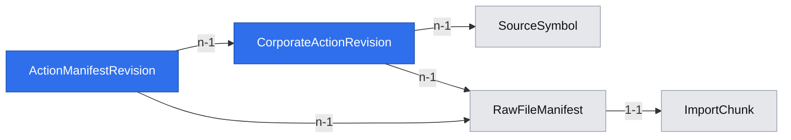

# GPW corporate actions from EODHD

## 📝 TLDR

The owner needs locally retained dividends and splits before later historical research. Today the archive imports EOD bars but does not import these events. The proposed feature would import EODHD dividends and splits through the existing quota-aware job and revision mechanisms, retaining the source response and any later correction. Historical index constituents are outside this feature.

## 📝 Problem Statement

Raw EOD prices alone do not show cash distributions or share-count changes. A later backtest needs these events with their source, dates and revisions, while an event whose publication time is unknown must not silently become a point-in-time input.

## 📝 Proposed Solution

Add dividend and split request types to the existing EODHD adapter and importer. Normalize source-backed event records into append-only revisions linked to checksummed raw responses. Repeated imports are idempotent; changed provider values create revisions. Expose committed event data to the separate snapshot capability without claiming coverage beyond the account's actual entitlement.

The per-symbol endpoints are preferable to EODHD's exchange-wide bulk feed for an initial, quota-limited archive: each dividend or split request costs one call and accepts an inclusive date window; bulk costs 100 calls per exchange/day. JSON is mandatory because dividend CSV omits declaration, record, payment, currency and unadjusted amount. Store `unadjustedValue` as the historical cash amount and `value` separately as EODHD's currently split-adjusted amount; never apply the latter to raw historical prices. [EODHD corporate-action API](https://eodhd.com/financial-apis/api-splits-dividends), [bulk API](https://eodhd.com/financial-apis/bulk-api-eod-splits-dividends). QuantConnect likewise models dividends and splits as distinct events rather than silently rewriting raw observations ([corporate actions](https://www.quantconnect.com/docs/v2/writing-algorithms/securities/asset-classes/us-equity/corporate-actions)); Lesine does not need its execution engine.

## 📝 Architecture

Extend the existing `POST /api/import-jobs` planner, worker lease/budget handling, checked raw-file manifest and append-only revision path. A job requests one data class, `dividends` or `splits`, for an explicit date range; each chunk is one symbol, one kind and one bounded provider request. The planner subtracts **completed request windows**, not dates with events: an empty response proves only that this source returned no event for that queried window. An explicit backfill rechecks the window to discover corrections. Failed or quota-paused requests retain committed chunks and old events. The current EOD coverage report remains EOD-only; issue #7 owns any new user-facing action report.

## 📝 Data Model

Migration 008 extends `import_jobs.data_classes` and `raw_file_manifests.data_class` checks, adds `import_chunks.data_class` with `daily_bars` backfilled for existing rows, and changes chunk uniqueness to `(job_id, resource_key, data_class, from_date, to_date)`. Existing EOD jobs and manifests keep their meaning. `CorporateActionRevision` has immutable UUID, provider, source-symbol FK, kind (`dividend`/`split`), ex-date, source event key, raw and normalized values, optional declaration/record/payment dates, currency, fingerprint, first-manifest FK, `first_seen_at`, availability evidence (`declaration_date_only`, `ex_date_only`, or `first_import`) and active/withdrawn state. The event key uses a provider event ID when present; otherwise `(provider, symbol identity, kind, ex-date)` only when one event of that kind exists on that date. Multiple same-day events without stable provider IDs are retained separately as unresolved and cannot be silently corrected or withdrawn. Repeated identical payloads deduplicate; an unambiguous changed amount or ratio appends a revision for the same logical event. `ActionManifestRevision` links every reimported manifest to the exact retained action revision. Both tables use the existing append-only trigger. No action record is silently mapped to a canonical instrument.

For dividends retain decimal `value`, decimal `unadjusted_value` when supplied, currency and nullable dates. For splits retain the original ratio string and parsed positive numerator/denominator; do not assume integers or only forward splits. A missing `unadjustedValue` is unknown, never replaced with the adjusted `value`. Source payloads remain private files and are covered by the existing combined database/file backup. This migration is forward-only; rollback restores the pre-migration bundle and prior image.

## 📝 API Contracts

`POST /api/import-jobs` accepts the existing envelope with exactly one of `data_classes: ["daily_bars"]`, `["dividends"]`, or `["splits"]`. It continues to require `provider=eodhd`, explicit valid ISO dates, `market_scope`, and `mode`; action requests may span a configured source-backed window beyond the EOD 367-day limit, but remain bounded by the 5 MB response check. Unknown class, bad date and mixed classes return `400 invalid_request`; an overlapping active job for the same class/scope returns `409 conflict`. `GET /api/import-jobs/{id}` and resume use the existing statuses and counters. Endpoint URLs are `/api/div/{SYMBOL}.WAR` and `/api/splits/{SYMBOL}.WAR` with lowercase `fmt=json`; credentials never enter client JSON or logs.

The action query used by the later snapshot reader returns source identity, kind, ex-date, historical amount/ratio, optional declaration date, `first_seen_at`, evidence code, revision ID and source-file hash. It does not promise an exact publication timestamp. Until a separate rule establishes historical availability, `first_seen_at` is an import observation and a strict past-cutoff snapshot must exclude the action or return `unknown_availability`.

## 📝 Edge Cases & Failure Scenarios

- Empty provider arrays are archived as successful **request windows**, not proof of lifetime absence. Invalid or unauthorized symbols, missing entitlements and malformed payloads produce explicit job errors.
- A 429 pauses until the provider's retry time; the local daily budget is reserved before every call, including retried attempts. Restart resumes only unfinished chunks.
- Invalid amounts, zero split denominator, absent currency for a dividend or response over 5 MB fail the chunk without publishing partial normalized rows. The old archive remains readable.
- A provider removes an event on a later recheck: preserve old revision and record an explicit withdrawal/tombstone tied to the new manifest; never delete earlier data.

## 📝 Risks & Impact Review

The changed `import_chunks` uniqueness and job class checks are migration-sensitive; existing EOD tests and the Angular import form are consumers. Action requests can use most of the daily allowance for 1,047 symbols, so the job reports planned/completed chunks and pauses at the configured budget. Actual WAR action depth, response size and entitlement need an authorized account sample; fixture success is not evidence of complete GPW history. The endpoint documents ex-dates but does not establish an exact timestamp at which a past value became public. The archive must preserve that uncertainty for future backtests.

## 📝 Decisions in play

R01 requires known-at evidence or an explicit limitation; R04 requires quota-aware missing-window retrieval and bounded rechecks. D07 permits implementation against a one-year sample before paid backfill. N01 and N02 remain untouched. The owner's 2026-11-05 scope decision excludes historical index constituents.

## 📋 Phasing

1. Import and retain dividends with bounded, quota-aware jobs.
2. Add splits and correction/withdrawal handling using the same revision mechanism.

## 📋 Implementation Plan

1. Add migration 008, EOD-preserving API validation and fixture tests for action-specific chunk identity and empty completed windows. Existing EOD import remains operational.
2. Add EODHD dividend parsing and worker dispatch through the existing lease/budget/manifest transaction. Test adjusted versus unadjusted values, two same-day events, retry, duplicate response, restart and source failure.
3. Add split parsing and append-only correction/withdrawal handling. Test fractional and reverse ratios, changed source payloads, old revision readability and combined archive backup/restore.
4. Verify a bounded WAR account sample if credentials and entitlement are available; otherwise record the source limit explicitly. Run build, tests and a Compose smoke test; clean the PR test environment afterward.

## 🧪 Review

Direction: proceed as the corporate-action importer of issue #6. Fresh-context scope review found one deployable capability; the snapshot reader and action UI remain separate. The API and schema changes preserve existing EOD behavior but require migration tests and a combined backup/restore check. Public EODHD documentation establishes endpoint shape and field meanings, not this account's WAR depth or publication timestamps; those remain acceptance limits.
