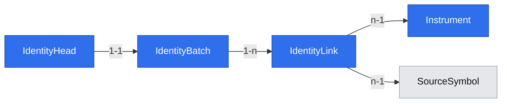

# Evidence-backed GPW instrument identities

## 📝 TLDR

The owner needs dated links between provider symbol identities and companies before using historical data by instrument. The current catalog preserves source identities but cannot prove that two ticker records refer to the same instrument across a rename or ticker reuse. The proposed feature would retain dated, evidence-backed links and leave ambiguous records separate.

## 📝 Problem Statement

Ticker text is not a durable company identifier. Joining historical records on the current ticker can merge different companies or lose a renamed one. The catalog already retains separate source symbols, but there is no dated, verified canonical link for later research.

## 📝 Proposed Solution

Store non-overlapping dated links from source identities to instruments, each with a reviewable evidence reference. Reject conflicting periods and preserve unlinked source records as unresolved. A later correction supersedes a link without erasing its former state.

The owner chose a local evidence file on 2026-11-05. Importing it is an explicit local action; the file is not inferred from EODHD ticker text or ISIN alone. QuantConnect's [security master](https://www.quantconnect.com/docs/v2/writing-algorithms/datasets/quantconnect/us-equity-security-master) illustrates why ticker changes belong to a dated identity record; that US-specific source is not a GPW feed and is not integrated here.

## 📝 Architecture

Add an offline `worker identities validate|import <path>` command. The file is a complete, versioned identity map: import validates every row, stores a checksummed private copy, inserts an immutable batch and links, then atomically moves an `identity_head` pointer. An invalid row rejects the whole batch; the former head remains active. Subsequent files supersede the full map, while old batches stay readable for snapshots. No network request or EODHD quota is spent. The API may read the current map and unresolved source identities, but cannot edit links. A future trusted connector can produce the same validated batch format.

## 📝 Data Model

`Instrument` has an opaque UUID and owner-chosen stable key; display name is optional and not an identity key. `IdentityBatch` has UUID, schema version, SHA-256, stored private-file reference, imported time and predecessor batch. `IdentityLink` has batch FK, source-symbol FK, instrument FK, valid-from date, exclusive valid-to date or null, evidence source/ref, and assertion date. `IdentityHead` points to exactly one published batch. Link rows and batches are append-only. Within one batch, a source identity may not map to two instruments over overlapping dates, and two identities may not claim the same provider-symbol interval for different instruments without explicit disambiguation. An empty batch is allowed to represent no verified links; it does not erase old batches.

The JSON file is UTF-8 with `schema_version: 1`, `links: [{source_symbol_id, instrument_key, valid_from, valid_to_exclusive, evidence: {source, ref, observed_at}}]`. `source` and `ref` identify a reviewable document; the importer verifies format, interval consistency and source-symbol existence, **not the factual truth of the cited document**. The UI/API labels these as `owner_attested`, not provider-verified. The raw file is copied into the private response bundle by content hash; backups include it. Path traversal, symlink outside the approved input directory, oversized file and duplicate keys are rejected. Migration is forward-only; rollback uses a pre-migration database/file bundle and prior image.

## 📝 API Contracts

CLI `identities validate <path>` returns validation errors without writing. `identities import <path>` returns `{batch_id, sha256, link_count, unresolved_count}` after the head publication transaction. Reimporting the same SHA-256 is idempotent. An older file can be explicitly reimported as a new head to roll back the active map without deleting history. Input path is local to the worker's configured owner-only import directory.

`GET /api/instruments/{id}/identities` returns the current batch ID and dated links with evidence refs; `GET /api/identities/unresolved` returns source-symbol IDs that have no active dated link, with pagination. Invalid ID → `404`; corrupt evidence file → `503 archive_corrupt`; neither endpoint guesses a canonical instrument. Both are loopback/read-only and use the existing JSON envelope. A snapshot later pins `IdentityBatch.id` so a corrected map cannot rewrite old research inputs.

## 📝 UI/UX

Issue #6 adds no edit screen. The Data page can show a link to a read-only identity summary when issue #7 extends it. The CLI reports the failing row and reason without dumping the full file or private path; the owner may correct the file and rerun validation.

## 📝 Edge Cases & Failure Scenarios

- Ticker reused by a different company: retain separate `SourceSymbol` records; refuse a conflicting interval rather than join on ticker text.
- Rename with incomplete evidence: leave the records unlinked and report unresolved. An ISIN or current catalog name alone does not establish a dated transition.
- Crash before head publication: orphan private copy may be quarantined; active head and previous batch remain intact. Crash after commit: head and links are visible together.
- Missing evidence file on read/backup: report archive corruption and keep earlier batches readable where their files remain valid.

## 📝 Risks & Impact Review

Manual evidence can be wrong. The app records who asserted the link (single local owner), when and from which document, and distinguishes attestation from provider fact. The opaque instrument key must never be derived solely from a ticker. An identity correction can change later derived universes, so snapshot consumers must pin a batch version. No existing EOD observations are rewritten or assigned to a company by migration.

## 📝 Decisions in play

R01 requires dated, source-backed identities for historical use. D07 allows the feature to be built before full-history acquisition. The owner selected a local evidence file on 2026-11-05. N01, N02 and the exclusion of index constituents remain unchanged.

## 📋 Phasing

1. Validate and publish an owner-attested identity batch without changing EOD history.
2. Expose the active batch and unresolved identities read-only to later snapshot and Data-page work.

## 📋 Implementation Plan

1. Add immutable instrument/identity-batch/link/head migration and validation-only CLI. Test unknown source symbol, overlapping intervals, ticker reuse, unsafe path and no-write failure.
2. Add private-file retention and atomic import/head switch with duplicate-hash idempotency. Test crash/rollback, reimport, backup/restore and old-batch readability.
3. Add read-only API queries and snapshot-facing batch lookup. Test pagination, missing/corrupt evidence and a corrected identity batch without changing EOD revisions.

## 🧪 Review

Direction: proceed with owner-attested local identity batches. Fresh-context scope review found one deployable capability. A source reference is an assertion supplied by the owner; the importer can validate shape and conflicts but cannot prove the external document's truth. The design avoids claiming EODHD supplies ticker-change history and does not rewrite retained EOD observations.
