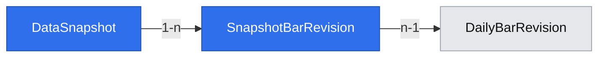

# Point-in-time archive snapshots

## 📝 TLDR

The owner needs reproducible historical inputs for future barometers and backtests. The archive already keeps source-backed EOD revisions, but has no stable way to pin and read the revision set known at a selected cutoff. The proposed feature would create immutable snapshot references and report unknown availability, identity ambiguity or broken provenance explicitly.

## 📝 Problem Statement

Reading the latest archive rows after a provider correction can change an earlier research result. The current stored `available_at` records first local import, not verified provider publication, so a historical cutoff cannot treat it as proof that data was publicly known then.

## 📝 Proposed Solution

Create a snapshot from committed revision references under a declared availability rule and archive generation. Read it without contacting the provider. Keep old snapshots readable after revisions; mark affected outputs stale for future consumers. When a row cannot satisfy the declared cutoff or its source file is missing, return an explicit error instead of silently selecting today's value.

QuantConnect's [corporate-action model](https://www.quantconnect.com/docs/v2/writing-algorithms/securities/asset-classes/us-equity/corporate-actions) distinguishes event time from adjusted price history. Lesine additionally pins the **archive version** so a later provider correction cannot retroactively change a saved research input. This feature does not calculate signals or backtests.

## 📝 Architecture

The snapshot service reads only committed PostgreSQL revisions and checksummed files. Creation takes an explicit data scope, date range, UTC cutoff and availability policy; it records exact revision IDs and the active identity-batch ID when that feature exists. A snapshot made before corporate-action or identity import may contain EOD bars only. Adding a new data class later does not change its contents. New revisions create a later snapshot; dependent outputs are marked stale by an event or lookup contract when those output tables exist, not by rewriting old snapshots.

Two policies are allowed: `strict_first_seen_v1` includes a revision only when its recorded first local import is at or before the decision cutoff; `research_assumed_v1` may use a documented next-session rule for an EOD bar but marks every such input as **assumed**, never verified. Corporate actions without a proven publication timestamp remain excluded under strict policy; an event date or dividend declaration **date** is not an exact publication time. A consumer must opt into the assumed policy and cannot label its result point-in-time verified. No policy selects a correction first imported after the cutoff.

## 📝 Data Model

`DataSnapshot` has UUID, created-at, `as_of_utc`, requested source-symbol/date/class scope, policy ID/version, archive-generation marker and evidence classification (`verified`, `assumed`, `incomplete`). `SnapshotBarRevision` has snapshot FK, observation key, EOD revision FK and availability evidence. Both are immutable. The snapshot transaction selects a consistent set under a database repeatable-read view and inserts the metadata and references together. It never stores adjusted values derived from future splits. A content fingerprint over sorted revision IDs, policy and scope supports reproducibility, not deduplication of different creation requests. When corporate-action and identity migrations exist, a later migration adds `SnapshotActionRevision` with an action-revision FK and a nullable `DataSnapshot.identity_batch_id` FK. The initial EOD-only migration does not reference tables that do not yet exist.

Existing EOD revisions get a migration generation baseline of 1; this means the app can reproduce post-migration snapshots, **not** reconstruct an archive version from before the migration. New EOD/action revision commits receive a monotonically increasing archive generation within the same transaction. Rows created after a snapshot's generation are never selected into it. Identity batches are pinned by ID independently. Migration and rollback require the existing coordinated database/file backup; no old response file or revision is deleted.

## 📝 API Contracts

Internal API `create_snapshot({as_of_utc, source_symbol_ids, data_classes, from_date, to_date, availability_policy}) -> {snapshot_id, archive_generation, identity_batch_id|null, evidence}`. Scope must be nonempty and dates valid; class must be supported and imported. Default policy is strict. Unknown availability on a required input yields `unknown_availability` with affected source/date; no partial snapshot is published unless the caller explicitly requested an allow-missing scope, in which case gaps and evidence classification are recorded. A strict request for a cutoff before first import cannot manufacture historical knowledge.

`read_snapshot({snapshot_id, data_class, source_symbol_id, from_date, to_date}) -> ordered rows` with revision ID, raw value, source file hash and availability evidence. An unknown ID returns `snapshot_not_found`; a missing/mismatched source file returns `snapshot_corrupt`; an ambiguous canonical identity returns `identity_unresolved` when a consumer requests instrument-level aggregation. Reads never call EODHD. A read returns the same rows after a newer correction; `is_stale` can be derived by comparing pinned revision IDs with current heads/generation, without mutating the snapshot. No public HTTP mutation endpoint is added in this feature; the barometer and validation specs will own their consumer-facing routes.

## 📝 Edge Cases & Failure Scenarios

- A provider recheck changes an EOD bar or action after snapshot creation: the old snapshot still reads its pinned revision; a new snapshot selects the new revision only when its first-seen time/policy permits it.
- Unknown or merely date-level publication evidence blocks strict historical use. The caller sees source/date and can choose an explicitly assumed research run later.
- An unfinished import or corrupt/missing manifest cannot enter a snapshot. If a file vanishes after creation, reads fail with `snapshot_corrupt`; never return a value without valid provenance.
- A huge scope is bounded by an explicit row limit or streaming batched creation under one consistent generation; timeout leaves no partial snapshot. Duplicate create requests may return a new immutable snapshot with the same fingerprint.

## 📝 Risks & Impact Review

The `as_of_utc` field could be mistaken for historical knowledge even though current EOD has only first-import evidence. Every API response carries the policy and evidence classification. R01 forbids calling assumed data a verified backtest. Materializing revision references is storage-intensive, so the first implementation enforces a documented bound and can later add an equivalent streamed path without changing old snapshots. Future consumers must migrate from latest-row queries to snapshot reads; there are no implemented indicator consumers yet. A schema rollback restores the pre-migration archive bundle and previous app image.

## 📝 Decisions in play

R01 is the governing known-at rule; D04 means later daily indicators use only information available after session close, and D07 permits mechanism testing on a one-year archive. N01 and N02 remain unchanged. Historical index constituents are not part of this feature.

## 📋 Phasing

1. Create and read strict immutable EOD snapshots with clear unknown-availability failures.
2. Include action revisions and an optional pinned identity batch when those separate capabilities are installed.

## 📋 Implementation Plan

1. Add migration and a transactional snapshot creator for committed EOD revisions, with strict availability policy, bounded scope and exact revision refs. Verify cutoff, correction, concurrent import and no-partial-write cases.
2. Add immutable reader and source-file integrity checks. Verify old snapshot after correction, missing file, unknown ID, restart and archive backup/restore.
3. Add action-revision and identity-batch adapters guarded by the presence of their migrations; verify ambiguous identity rejection and date-only action evidence. Expose a stable internal contract to the later indicator/test modules.

## 🧪 Review

Direction: proceed with EOD-only snapshots first, then optional action/identity adapters. Fresh-context scope review found one capability and confirmed the later adapters do not need to ship with the initial reader. The initial schema references only existing EOD tables; later migrations add foreign keys for new classes. Strict first-seen snapshots cannot certify a period before local import, so future historical results must expose that limit rather than claim verified point-in-time performance.
