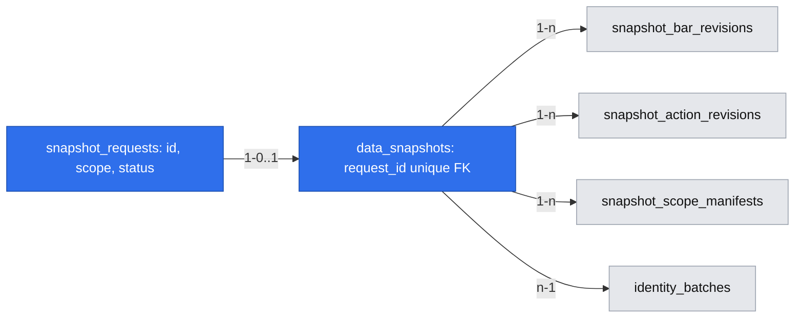

# Historia migawek i korekt GPW

## 📝 TLDR

Archiwum Lesine potrafi tworzyć i odczytywać niezmienne migawki, ale obecnie są to wewnętrzne funkcje workera bez ścieżki obsługi na `/data`. Proponowana część #7 ma pokazać wersje danych, skutki korekt i możliwość odczytu starszych migawek, nie zmieniając ich zapisanej treści.

## 📝 Problem Statement

Rewizje EOD i działań są zachowywane, a wewnętrzne `createSnapshot`/`readSnapshot` potrafią przypiąć wersje danych. Nie ma jednak publicznego wywołania, które tworzy migawkę na żądanie właściciela, ani widoku jej historii i skutków późniejszej korekty. Samo porównanie najnowszych wierszy nie odtwarza tego, co było zapisane w starszej migawce.

## 📝 Proposed Solution

Umożliwić właścicielowi ręczne utworzenie ograniczonej migawki dla wskazanego zakresu z `/data`, a następnie wyświetlać metadane, dowody i różnice między dwoma wersjami bez przepisywania wcześniejszej. Specyfikacja zachowuje etykiety `verified`/`assumed`/`incomplete` i jawnie opisuje brak danych. [QuantConnect LEAN](https://www.quantconnect.com/docs/v2/writing-algorithms/securities/asset-classes/us-equity/data-preparation) odróżnia surowe dane od historii skorygowanej o działania korporacyjne; Lesine udostępnia przypięte surowe rewizje i nie dodaje tu silnika korekt cen ani testu strategii.

## 📝 Architecture

Użytkownik tworzy żądanie w `/data`; NestJS zapisuje je w nowej kolejce `snapshot_requests`, a istniejący worker odbiera je w swoim cyklu i wywołuje dotychczasowe `createSnapshot`. Oddzielenie żądania od operacji chroni interfejs przed długim przetwarzaniem i nie tworzy drugiej implementacji wyboru rewizji. Worker zapisuje wynik lub kod błędu, a UI odczytuje status. Odczyt metadanych i porównania działa w API na tabelach migawek; weryfikacja plików i odczyt zawartości powinny korzystać z jednego współdzielonego modułu archiwum wyodrębnionego z `apps/worker/src/snapshots.ts`, zamiast kopiowania polityki wyboru danych. Worker i API nie wywołują EODHD przy tworzeniu/odczycie migawki.

W istniejącej [specyfikacji archiwum](implemented/2026-11-05-point-in-time-archive-snapshots.md) publiczny endpoint tworzenia odłożono do późniejszej funkcji. Właściciel zdecydował teraz, że ręczne tworzenie jest częścią #7; ten dokument jest właścicielem nowego punktu wejścia, bez zmiany semantyki zapisanych migawek.

## 📝 Data Model

Nowa `snapshot_requests`: UUID, zweryfikowany zakres (`as_of_utc`, lista `source_symbol_ids`, klasy, daty, polityka, `allow_missing`), `status` (`queued|running|done|failed`), daty utworzenia/aktualizacji, kod i bezpieczne szczegóły błędu po niepowodzeniu. `data_snapshots.request_id` jest unikatowym FK do żądania; transakcja `createSnapshot` zapisuje go razem z migawką. Worker przejmuje atomowo jedno żądanie (`FOR UPDATE SKIP LOCKED`), a restart odzyskuje osierocone `running` po dzierżawie. Przed ponowieniem sprawdza migawkę o tym `request_id`; nie publikuje dwóch wyników dla jednego żądania. Żądania są lokalne i nie zawierają sekretów.

`data_snapshots`, `snapshot_bar_revisions`, `snapshot_action_revisions` i `snapshot_scope_manifests` pozostają niezmienne. Porównanie opiera się na ich przypiętych ID rewizji i manifestów, nie na zmianie globalnej `archive_generation` samej w sobie. Stare migawki pozostają adresowalne. Nowa migracja jest addytywna; przy cofnięciu obrazu potrzebna jest kopia bazy i archiwum zgodnie z zasadami projektu.

## 📝 API Contracts

- `POST /api/snapshot-requests`: ciało zgodne z `CreateSnapshotInput`: `as_of_utc`, niepusta lista `source_symbol_ids`, niepuste `data_classes` (`daily_bars|dividends|splits`), `from_date`, `to_date`, opcjonalne `availability_policy` (domyślnie `strict_first_seen_v1`) i `allow_missing` (domyślnie `false`). Walidacja powtarza granice istniejącej funkcji: do 500 symboli, do 367 dni włącznie, do 50 tys. kombinacji symbol/dzień i rekordów/manifestów. `202 {data:{request_id,status:queued}}`. Istniejąca ochrona lokalnego dostępu i CSRF obejmuje POST. To nie uruchamia importu.
- `GET /api/snapshot-requests/{id}`: `status`, `snapshot_id|null` wyznaczony przez `data_snapshots.request_id`, bezpieczny `error_code|null`, `created_at`, `updated_at`; nieznany ID → `404`.
- `GET /api/snapshots?cursor=<opaque>`: lista metadanych (limit 50, stabilne `created_at,id`): ID, cutoff, zakres, klasy, polityka, `archive_generation`, `identity_batch_id`, `evidence`, `evidence_scope:local_first_seen`, liczba `missing`, fingerprint. `GET /api/snapshots/{id}` zwraca metadane i listę braków. Surowych ścieżek nie zwracać.
- `GET /api/snapshots/{id}/rows?data_class=...&source_symbol_id=...&from_date=...&to_date=...&cursor=...`: stronicowane przypięte rewizje z ID, datą, wartościami źródłowymi, lokalnym dowodem dostępności i skrótem pliku. Zachować walidację i kontrolę integralności istniejącego `readSnapshot`; nie ładować 50 tys. wierszy do przeglądarki naraz.
- `GET /api/snapshots/compare?older=<uuid>&newer=<uuid>`: tylko dla zgodnego zakresu symboli/klas/dat i tej samej polityki; zwraca ID, daty utworzenia, dowody i zliczenia dodanych, usuniętych oraz zmienionych przypiętych rewizji, manifestów i partii tożsamości. Rozbieżny zakres → `409 incompatible_scope`. Wynik jest porównaniem dwóch migawek, a nie prognozą ani potwierdzeniem pełności danych.
- Błędny zakres → `400`; nieznana dostępność → `failed/unknown_availability` ze skończoną listą braków, chyba że użytkownik jawnie wybrał `allow_missing`; uszkodzony plik → `503 snapshot_corrupt` dla odczytu lub `failed/snapshot_corrupt` dla tworzenia. Nie eksponować ścieżek ani treści plików.

## 📝 UI/UX

Na `/data` formularz wyboru symboli, klas, przedziału i czasu `as_of_utc`; domyślnie ścisła polityka i brak zgody na luki. Polityka badawcza `research_assumed_v1` i `allow_missing` wymagają jawnego zaznaczenia z objaśnieniem: `verified` oznacza tylko lokalną dostępność przed cutoffem, nie potwierdzoną publikację rynkową. Po wysłaniu pokazać kolejkę, pracę, sukces albo błąd bez blokowania strony. Lista migawek pozwala otworzyć starą i nową wersję oraz porównać kompatybilny zakres; obie wersje pozostają czytelne. Przy nowszej korekcie zakresu pokazać „dostępna nowsza wersja danych” tylko po faktycznym porównaniu przypiętych rewizji dla tego samego zakresu; sama zmiana globalnej generacji tego nie dowodzi. Etykiety błędu, luk i stanów są czytelne bez koloru oraz obsługiwane klawiaturą.

## 📝 Edge Cases & Failure Scenarios

- Mac/worker wyłącza się po przyjęciu żądania: żądanie pozostaje w bazie i jest wznawiane po starcie; zakończonego snapshotu nie tworzy się drugi raz.
- Cutoff wcześniejszy niż pierwszy lokalny import nie dostaje pozornej weryfikacji. Akcje bez dokładnego czasu publikacji są wykluczone w trybie ścisłym; tryb badawczy oznacza założenia.
- Brak uprawnienia EODHD lub wyczerpana kwota nie blokuje odczytu zapisanych migawek, bo endpointy nie korzystają z dostawcy.
- Błąd integralności pliku, nieznany symbol, nadmierny zakres, niejednoznaczna tożsamość przy odczycie na poziomie instrumentu i zmiana aktywnej partii tożsamości mają odrębne kody; stary snapshot zachowuje przypiętą partię.
- W dwóch snapshotach mogą wystąpić różne zakresy lub polityki; UI wyłącza porównanie i wyjaśnia niezgodność, lecz pozwala każdy z nich osobno odczytać.

## 📝 Risks & Impact Review

Nowa kolejka i endpoint tworzenia są trwałym kontraktem. Dodanie opcjonalnego `request_id` do wewnętrznego `createSnapshot` zachowuje dotychczasowych konsumentów. Unikatowy FK jest kluczem idempotencji przy awarii między utworzeniem migawki a aktualizacją statusu żądania. Porównanie nie może nazwać snapshotu „starym” tylko z powodu globalnej generacji. R01 zabrania nazywania `assumed` zweryfikowaną historią. Usunięcie UI/API nie wymaga kasowania już utworzonych migawek; rollback danych wyłącznie z kopii całego archiwum.

## 📝 Decisions in play

R01, R04 i D07: dowody dostępności, zachowanie archiwum po błędach i możliwość pracy na rocznym wycinku. N01/N02 bez zmian. Decyzja właściciela z tej rozmowy: ręczne tworzenie migawki na `/data` należy do #7 i uzupełnia wcześniejszą specyfikację wewnętrznego archiwum.

## 📋 Phasing

1. Trwałe żądanie ręcznej migawki i wykonanie przez worker.
2. Lista oraz odczyt zapisanych migawek na `/data`.
3. Porównanie dwóch zgodnych migawek i informacja o korekcie.

## 📋 Implementation Plan

1. Dodać migrację kolejki i atomowe przejęcie/ponowienie w workerze z wywołaniem istniejącego `createSnapshot`; sprawdzić awarię przed i po zapisie wyniku oraz pojedyncze opublikowanie. Istniejący import działa nadal.
2. Dodać POST/status API z walidacją i CSRF; sprawdzić błędny zakres, brak dostępności, jawne `allow_missing`, zatrzymanie workera i wznowienie po restarcie.
3. Wyodrębnić współdzielony odczyt archiwum, dodać paginowane API listy/metadanych/wierszy i ekran Angular; sprawdzić niezmienność starszego odczytu po korekcie i wykrycie uszkodzonego pliku.
4. Dodać porównanie zgodnych migawek i UI; sprawdzić zmianę rewizji EOD, działania, partii tożsamości, brak różnic mimo zmiany globalnej generacji oraz niezgodne zakresy. Każdy etap zostawia działającą aplikację.
