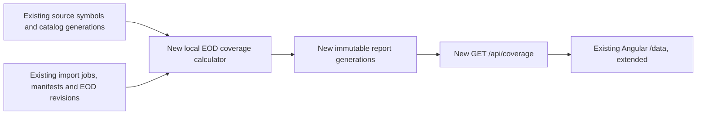
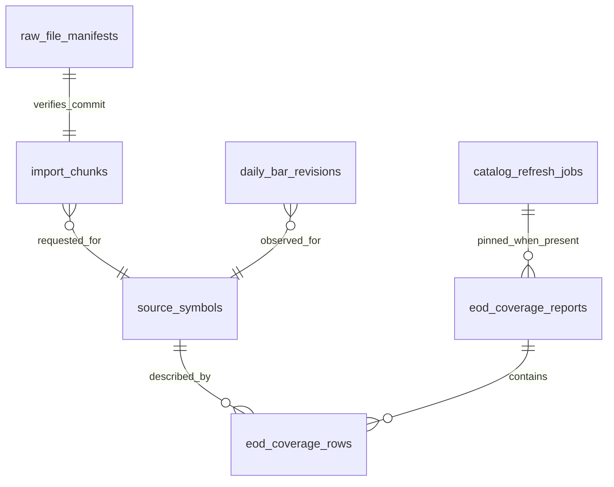

# EOD coverage and gap view

## 📝 TLDR

The owner can see the source catalog and import progress on `/data`, but cannot inspect which EOD dates are locally archived or which import requests remain unfinished. This specification defines a dated EOD report and filterable import evidence derived from committed local data. Provider depth remains unverified. Implementation is tracked in PR #23.

## Resolved assumptions (autonomous defaults)

| Question | Chosen answer | Reason |
|---|---|---|
| Q1. Persist a last-good report or calculate only on request? | Persist immutable report generations, computed locally when archive evidence changes. | The accepted `/data` behavior requires a timestamped prior report after a refresh failure. |
| Q2. Include identities outside the current catalog? | Include every retained `source_symbols` identity; mark current-catalog membership. | Historical and delisted identities must not disappear after a catalog refresh. |
| Q3. Call absent dates gaps without trading evidence? | Do not infer calendar gaps between returned observations; report unfinished requests. | A requested calendar range or empty response does not prove trading on every date. |

## 📝 Problem Statement

Issue [#5](https://github.com/pawelfree/lesine/issues/5) and the accepted [archive specification](../2026-11-04-local-gpw-history-with-coverage.md) require an acquired EOD range report. Before this implementation, `/data` showed catalog rows, a bounded provider-depth sample and import-job chunk counts, but no coverage report. The app already stores source identities, import chunks, checksummed response manifests and EOD revisions. A `done` import means requests completed, not that GPW history is complete; a one-year development window is not the full archive target ([D07/R04](../product-brief.md)). The subsequent [removal decision](../2026-11-05-remove-expected-coverage.md) updates this contract.

The problem is an owner requirement, not an observed loss or a validated investment outcome. Source entitlement, historical depth, Main/NewConnect classification and retention rights still require account-level evidence (product brief Q03/Q06). This specification does not turn those unknowns into completeness claims.

## 📝 Proposed Solution

Add one read-only EOD coverage capability: derive a versioned report from committed local archive evidence, serve it through `GET /api/coverage`, and display its timestamp, acquired range, filters and import evidence on `/data`. Refreshing the report makes **no provider request and uses no EODHD quota**. Each generation records its source-catalog id and archive watermark.

This follows the accepted [low-fidelity `/data` reference](../assets/local-gpw-history/data-coverage-wireframe.md), accepted on 2026-11-04 for the archive coverage page. This issue excludes provider history acquisition, exchange calendars, instrument identity linking, corporate actions, index membership, barometer calculation and trading. Those are independent capabilities in the parent spec. An EOD view never labels the full GPW archive complete.

Persisting reports supports a last-good result after calculation failure. Calculating from completed import chunks alone would conflate request progress with observations. Retained source identities remain visible even when not in the current catalog.

## 📝 Architecture



Each `GET /api/coverage` computes a deterministic fingerprint of **all report inputs** in one PostgreSQL snapshot: retained source identities and current catalog membership, import-job/chunk requested ranges and states, committed manifest references and distinct EOD revision keys. A new queued, failed or completed chunk therefore changes the fingerprint even before a manifest exists; a catalog publication or correction does too. The API calculates and commits a new report generation when that fingerprint differs from the latest one. This check must be bounded and measured against the target archive size; an indexed aggregate or transactional change counter may be used if the same input coverage is preserved. A subsequent GET is the retry path; there is no separate refresh command or scheduler. It never invokes EODHD. If calculation fails after a prior generation, the API serves that last good generation with `refresh_status: "stale"`, its original timestamp and a sanitized reason; it does not advance the watermark. If no prior report exists, calculation failure returns `503 coverage_unavailable`. If the API itself is unreachable, Angular may display its last loaded first page and summary from bounded browser storage, explicitly timestamped and labeled cached. That cache is display-only, never research evidence. A `403` hides and clears it.

## 📝 Data Model

Add append-only `eod_coverage_reports` and `eod_coverage_rows` via a forward-only PostgreSQL migration. A report stores `id`, `created_at` (calculation time), nullable `archive_last_committed_at` (last manifest-backed EOD acquisition), nullable `catalog_id`, archive watermark and `calculation_version`. A row stores report id, `source_symbol_id`, provider, symbol, market segment (`main|newconnect|unclassified`), listing (`active|delisted|unknown`), `in_current_catalog`, `data_class` fixed to `daily_bars`, nullable acquired start/end dates, status and bounded import findings with reason/evidence codes. Unique `(report_id, source_symbol_id, data_class)` prevents duplicates. Source identity is not a canonical instrument id.



Existing tables remain unchanged. Report generations and rows are immutable once committed. The newest generation is selected for display; older generations remain stored in this issue's scope. Retention or pruning would require a separate decision and migration. Reports can be rebuilt from retained evidence. Take the repository's coordinated PostgreSQL and response-file backup before migration.

**Range and count meanings:**

- `acquired_from/to` come from distinct committed `daily_bar_revisions` session dates backed by valid manifests. When a report exists, `acquired` counts distinct `(source_symbol_id, session_date)` pairs across **all rows matching market, listing, data-class, source and status filters**, not only the current page. A corrected revision does not add a date. When no report exists, the count is `null` under the parent contract.
- A completed empty manifest proves an archived response, not that every day was a trading day or that history is unavailable. An unfinished chunk is an **import-request problem**. Dates between returned observations produce no finding.
- The report does not assert full historical completeness. Unknown dates/counts use JSON `null`, never zero; zero means a verified empty set.

Rows are keyed by `source_symbol_id`, so repeated ticker text, delisted and unclassified identities remain distinct. A row may be `unclassified` while still showing acquired EOD dates. Old identities outside the current catalog are labeled retained. Evidence references are opaque manifest/catalog ids or safe public documentation links, never raw payloads, credentials or private paths.

## 📝 API Contracts

Extend the parent spec's local `GET /api/coverage` contract for **EOD only**. Existing catalog and import-job responses remain unchanged. Use the existing success `{data, page}` and sanitized error envelope; timestamps are ISO 8601 UTC and market dates `YYYY-MM-DD`.

`GET /api/coverage` accepts optional `market=all|main|newconnect|unclassified`, `listing=all|active|delisted|unknown`, `data_class=daily_bars`, `source=eodhd`, `status=all|unavailable|unclassified|unknown`, `limit=1..200` (default 50), and opaque `cursor`. Invalid filters, limits or cursor return `400 invalid_request`; local access denial returns `403 access_denied`. Response:

```json
{
  "data": {
    "report_id": "uuid-or-null", "created_at": "UTC-or-null", "archive_last_committed_at": "UTC-or-null",
    "refresh_status": "none-or-fresh-or-stale",
    "refresh_error_code": null, "catalog_id": "uuid-or-null", "archive_watermark": "opaque-or-null",
    "scope": {"market":"all","listing":"all","data_class":"daily_bars","source":"eodhd","status":"all"},
    "summary": {"acquired":2},
    "rows": [{"source_symbol_id":"stable-id","provider_symbol":"ABC.WAR","market_segment":"unclassified",
      "listing":"active","in_current_catalog":true,"data_class":"daily_bars","source":"eodhd",
      "acquired_from":"2026-01-02","acquired_to":"2026-11-04","status":"unclassified",
      "findings":[]}]
  },
  "page": {"next_cursor":null}
}
```

The example values are illustrative, never seeded data. With no source identity, catalog or committed archive evidence, the API follows the parent contract: no generation is written and the response has `report_id`, `created_at`, `archive_last_committed_at` and watermark `null`, `refresh_status: "none"`, nullable acquired count and no rows. If a source identity or committed archive evidence exists but no bars do, the generated report has acquired `0`. A failed first calculation returns `503 coverage_unavailable` with the existing error envelope. Each row's bounded findings are its import details; no `GET /api/instruments/{id}/coverage` yet because verified canonical links do not exist. The UI maps safe reason codes to Polish. Summary spans the **entire filtered report**, not just one page. Cursor binds report id, normalized filters and last row key; changing report or filters invalidates it. Sort deterministically by market, listing, symbol and source identity. The endpoint never fetches a provider or exposes local paths.

## 📝 UI/UX

Extend Angular `/data` below catalog/import sections with “Zakres notowań EOD”. Keep the accepted [wireframe](../assets/local-gpw-history/data-coverage-wireframe.md) and its scope; no new prototype is claimed. Header: report calculation timestamp, last committed EOD acquisition timestamp and catalog generation. `refresh_status: "fresh"` means the calculation matches **local evidence**, not that the provider is reachable or that EOD data are current. Combine it with the existing import-job status and update time: after a source outage, the acquired rows remain readable, the older acquisition time stays visible, and a failed/quota-wait source is never labeled fresh. The acquired count is labeled; null renders “nieznane”. Filters cover Main/NewConnect/unclassified, active/delisted/unknown and status. Source and data class are labeled selectors with one supported option each (`EODHD`, `EOD`) until another adapter/class exists; they do not imply other providers are available. Rows show acquired date ranges and import evidence details only when present. Retained identities outside the current catalog carry an explicit label.

States: loading; empty archive; partial/unknown; calculation failure with prior report; API outage with timestamped cached first page; access denied with no data; import `queued/running/quota_wait/paused/failed/done` alongside coverage. The existing job section supplies retry time, last update and safe error mapping; job `done` never changes coverage status. Stale and cached reports cannot use fresh wording. If filters change offline, explain that cached rows reflect previous filters. At narrow widths, controls stack and rows remain readable. Labels, table headers, visible focus and keyboard-operable details carry every status conveyed by color.

No new mockup was made during this spec run because there is no prepared test-environment descriptor. The accepted wireframe is the design reference; implementation QA must inspect the actual screen.

## 📝 Edge Cases & Failure Scenarios

| Case | Required result |
|---|---|
| First launch, no catalog, source identity or archive evidence | No report: null id/time/counts, empty rows, unknown scope; no global complete claim. |
| Active, delisted, unclassified identities; repeated ticker | Separate source-id rows and evidence under market/listing filters. |
| New catalog replaces old | Retained identities remain browsable; pinned catalog id and membership distinguish versions. |
| Empty response, weekend, halt or pre-listing date | Archived empty response is identified; no date-gap finding is inferred. |
| Partial import, quota wait or failed job | Only committed revisions count; job status and retry remain visible. |
| Archive commit races report calculation | One consistent generation; later read refreshes on watermark change. |
| Refresh fails; API later unavailable | Last-good report keeps original time and stale label; browser cache is bounded and marked cached. |
| Source outage after an earlier report | Acquired rows remain readable; last committed acquisition time is unchanged, and the failed job is shown separately from report calculation time. |
| Browser cache corrupt/outdated or `403` | Clear/hide cache; never display it as current or expose rows on access denial. |
| Provider depth/rights unverified | Bounded sample remains labeled sample; no full-history claim is made. |

## 📝 Risks & Impact Review

The primary risk is presenting request coverage or a one-year sample as historical completeness. The report shows only acquired observations and explicit import evidence; it makes no completeness claim. Report tables and API are local contracts; future changes require migration/client coordination under [BACKWARD_COMPATIBILITY.md](../../../BACKWARD_COMPATIBILITY.md). A pre-migration coordinated backup is required. Browser cache is display-only and cannot satisfy a research snapshot or validation run.

Research check: [QuantConnect's history guidance](https://www.quantconnect.com/docs/v2/writing-algorithms/historical-data/history-responses) notes that absent points can reflect illiquidity, pre-IPO dates or data issues; its [data-issue guidance](https://www.quantconnect.com/docs/v2/cloud-platform/datasets/data-issues) also names halts and delistings. Lesine adopts the narrower lesson that an absent calendar date needs classification evidence before becoming a confirmed data gap. Fill-forward and a security master are outside issue #5.

## 📝 Decisions in play

- D07: free-tier data are development input, not a reduced full-history goal.
- R04: partial imports are not complete; normal sync avoids committed ranges and bounded rechecks can find corrections.
- N01: no automated trading.
- Q03/Q06 remain source/account evidence gates for real-data completeness and first-stage acceptance, not fixture-based development blockers.

## 📋 Phasing

One independently deployable capability in two steps: a local, source-free EOD report API, then its `/data` presentation. Each step leaves catalog and importer usable. Full archive reconciliation and non-EOD classes remain in the parent spec's later phase.

## 📋 Implementation Plan

1. **Report storage and API.** Add migration, calculation from identities, job/chunk state, committed manifests/revisions, retained generations, filters/pagination and safe stale fallback. Fixture checks cover current/retained and active/delisted/unclassified identities, no-report null semantics, an existing catalog with zero bars, unknown scope, empty responses, correction revisions, queued→failed and queued→done chunk transitions without a manifest, same-ticker identities, concurrent archive change, cursor invalidation and failed refresh retaining the prior report. Assert zero EODHD calls on report reads and measure fingerprint/read time at the intended symbol/chunk volume. Run configured build and API integration tests.
2. **`/data` view.** Add report section, bounded display-only cache, filters and finding details, loading/offline/403 states and Polish reason mapping while reusing import-job status. Fixture checks cover keyboard and narrow-screen navigation, quota wait, paused/failed job and outage after a successful report. Run a Compose smoke test in an isolated project/ports and remove that temporary environment afterward. Without Q03/Q06 evidence, describe the result as an EOD reporting mechanism, not verified complete GPW history.
